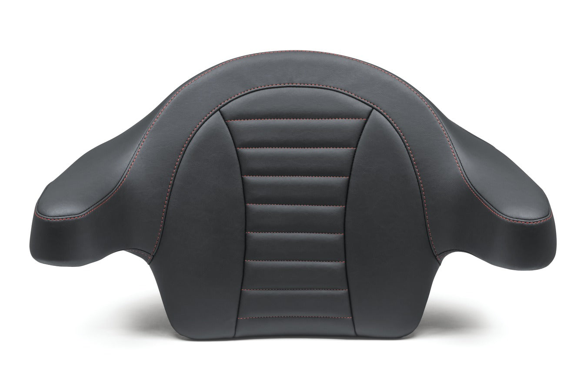

# Mustang Motorcycle Seats 79014 Super Touring Deluxe Extended Arm Wrap-Around Backrest for Harley-Davidson Electra Glide Standard, Road Glide, Road King & Street Glide 2014-'21, Deluxe, Black

[All parts](../README.md) · [System](../systems/seating.md)

*Photo: Manufacturer catalog photograph for exact Mustang 79014 variant.*

| Field | Record |
| --- | --- |
| Status | Shipped |
| Quantity | 1  |
| Part number | 79014 |
| Part-number evidence | Order / packing-slip evidence |
| Order / source | Amazon 111-2609970-1826658 |
| Order date | 2026-07-13 |
| Documentation checked | 2026-10-23 |

## Product and installation documents

- [Ordered product listing](https://www.amazon.com/dp/B071NRDCDD?ref_=pe_123509780_1038749300_i_fed_asin_title)
- [Product reference](https://www.mustangseats.com/products/deluxe-extended-arm-wrap-around-backrest-for-harley-davidson-fl-touring-2014-2025?variant=49592191025464)
- [FL wrap-around backrest 2014–2018 instructions](https://cdn.shopify.com/s/files/1/0789/7022/4952/files/FL_Wrap-around_Backrest_14_up_web_NEW_MOUNT_INSTR.pdf?v=1727878946) — Manufacturer linked mounting instructions for this product
- [Downloaded PDF copy: FL wrap-around backrest 2014–2018 instructions](../manuals/amazon-b071nrdcdd-19770380.pdf)

## Build notes

- Historical order evidence; installation not established.
- Factory product JSON verified variant 49592191025464 is SKU 79014: Black / Deluxe / Black.
- Requires King Tour-Pak; manufacturer says not for Chopped or Razor Tour-Pak. Confirm current Tour-Pak before reinstallation during body work.

## Evidence

- Gmail message 19f62549413f0258; order reference Amazon 111-2609970-1826658

## Builder record

- [ ] Received and box label matched
- [ ] Hardware and instructions present
- [ ] Installed / retained / superseded decision recorded
- [ ] Function checked

Installed date: __________  Technician: __________

Notes: ____________________________________________________
