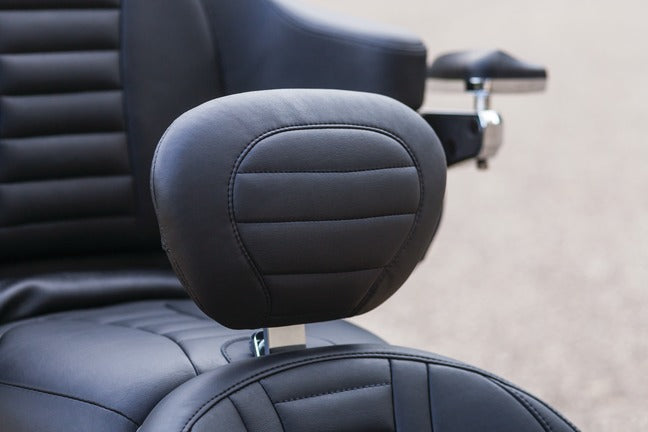

# Mustang Motorcycle Seats 79012 Super Touring Deluxe Driver Backrest for Harley-Davidson Electra Glide Standard, Road Glide, Road King & Street Glide 2008-'21, Deluxe, Black

[All parts](../README.md) · [System](../systems/seating.md)

*Photo: Manufacturer catalog photograph for exact Mustang 79012 variant.*

| Field | Record |
| --- | --- |
| Status | Shipped |
| Quantity | 1  |
| Part number | 79012 |
| Part-number evidence | Order / packing-slip evidence |
| Order / source | Amazon 111-0190428-7600217 |
| Order date | 2026-07-10 |
| Documentation checked | 2026-10-23 |

## Product and installation documents

- [Ordered product listing](https://www.amazon.com/dp/B087KCRMDS?ref_=pe_123509780_1038749300_i_fed_asin_title)
- [Product reference](https://www.mustangseats.com/products/super-touring-deluxe-driver-backrest-for-harley-davidson-fl-touring-2008-2025?variant=48495463039288)
- [One-piece seat instructions: using a backrest, page 3](https://cdn.shopify.com/s/files/1/0789/7022/4952/files/FL_08_up_One_Piece_web_NEW_MOUNT_INSTR.pdf?v=1731957313) — Seat-mounted backrest method; separate 79012-specific PDF not found
- [Downloaded PDF copy: One-piece seat instructions: using a backrest, page 3](../manuals/amazon-b087kdk9cp-cea451a4.pdf)

## Build notes

- Historical order evidence; installation not established.
- Factory product page identifies SKU 79012, 12-inch width, removable and adjustable support, mounted into the seat receiver.
- Use the straight-post seat-receiver method described on manual page 3; this is not the separate frame-mounted backrest kit.

## Evidence

- Gmail message 19f4e854a5c65da0; order reference Amazon 111-0190428-7600217

## Builder record

- [ ] Received and box label matched
- [ ] Hardware and instructions present
- [ ] Installed / retained / superseded decision recorded
- [ ] Function checked

Installed date: __________  Technician: __________

Notes: ____________________________________________________
