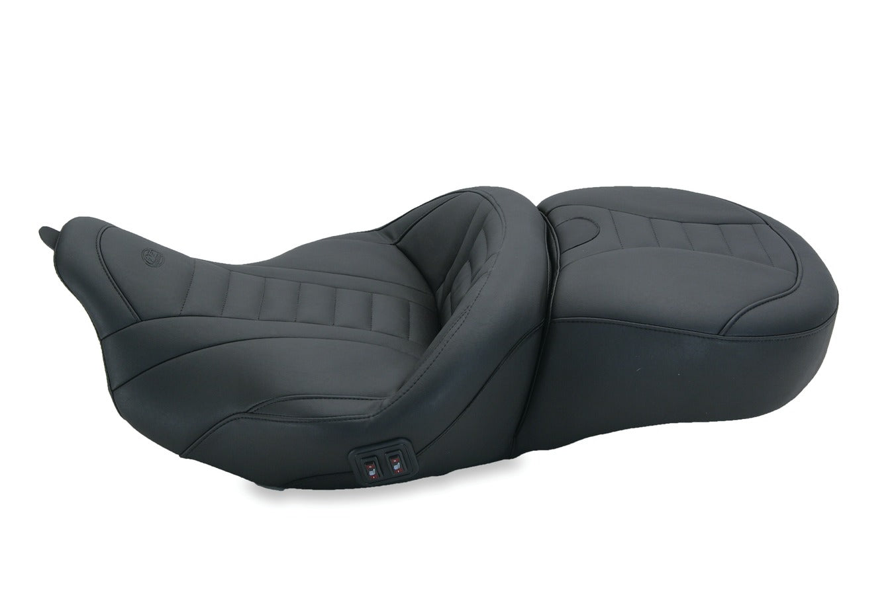

# Mustang Motorcycle Seats 79007 Super Touring Deluxe Heated One-Piece Seat for Harley-Davidson Electra Glide Standard, Road Glide, Road King & Street Glide 2008-'21, Deluxe, Black, Extended Reach

[All parts](../README.md) · [System](../systems/seating.md)

*Photo: Manufacturer catalog photograph for exact Mustang 79007 variant.*

| Field | Record |
| --- | --- |
| Status | Delivered |
| Quantity | 1  |
| Part number | 79007 |
| Part-number evidence | Order / packing-slip evidence |
| Order / source | Amazon 111-7807633-2873836 |
| Order date | 2026-07-07 |
| Documentation checked | 2026-10-23 |

## Product and installation documents

- [Ordered product listing](https://www.amazon.com/dp/B087KDK9CP?ref_=pe_148126100_1193965070_i_fed_asin_title)
- [Product reference](https://www.mustangseats.com/products/super-touring-deluxe-one-piece-2-up-for-harley-davidson-fl-touring-2008-2025?variant=48495466021176)
- [FL Touring one-piece mounting instructions](https://cdn.shopify.com/s/files/1/0789/7022/4952/files/FL_08_up_One_Piece_web_NEW_MOUNT_INSTR.pdf?v=1731957313) — Exact 79007 included in part-number list on last page
- [Downloaded PDF copy: FL Touring one-piece mounting instructions](../manuals/amazon-b087kdk9cp-cea451a4.pdf)

## Build notes

- Historical order evidence; installation not established.
- Factory product JSON verified variant 48495466021176 is SKU 79007: Black with Driver Backrest Receiver Heated / Deluxe / Black.
- Built-in driver-backrest receiver; driver backrest sold separately and ordered as 79012.
- Heater electrical connection must be checked on bike. Current Mustang/dealer documentation calls for adapter 69201599 on 2017+ Touring; adapter purchase not yet established.
- Current manufacturer photo is exact 79007 variant photo.

## Kit / assembly itemization

Components are grouped with this product. Separately indexed equipment and assembly references are not additional purchases. Read each row’s inclusion note.

| Included component | Quantity | Part number | Reference | Inclusion / identification note |
| --- | --- | --- | --- | --- |
| Heated one-piece rider/passenger seat with integrated driver-backrest receiver | 1 | 79007 | [Parent product / kit reference](https://www.mustangseats.com/products/super-touring-deluxe-one-piece-2-up-for-harley-davidson-fl-touring-2008-2025?variant=48495466021176) |  |

**Kit documentation gap:** Some internal parts have only an illustrated kit/manual reference; separate retail listings or service SKUs were not verified. Do not treat a parent-kit link as a standalone component offer.

## Evidence

- Gmail message 19f4d0c5aa3e7919; order reference Amazon 111-7807633-2873836

## Builder record

- [ ] Received and box label matched
- [ ] Hardware and instructions present
- [ ] Installed / retained / superseded decision recorded
- [ ] Function checked

Installed date: __________  Technician: __________

Notes: ____________________________________________________
