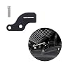

# Harley Neutral Gear Assist Kit Shifting Easier, Gear Shift Assist Fit for 2018+ Harley Touring, 2018+ Softail, Makes Shifting 20% Easier, Black

[Home](../README.md) · [All parts A–Z](../PARTS_INDEX.md) · [System](../systems/controls.md)

| Field | Record |
| --- | --- |
| Status | Delivered |
| Quantity | 1  |
| Part number | Not confirmed |
| Order / source | Amazon 111-1121820-2638611 |
| Documentation checked | 2026-10-23 |

## Product and installation documents

- [Ordered product listing](https://www.amazon.com/dp/B0DJ29KWG8?ref_=pe_148126100_1193965070_i_fed_asin_title)
- An exact public installation manual was not located. Obtain the product-specific instructions from the manufacturer or use the applicable Harley service procedure for OEM replacement parts.

## Build notes

- Historical order evidence; installation not established.

## Evidence

- Gmail message 19fba913c01199b3; order reference Amazon 111-1121820-2638611

## Builder record

- [ ] Received and box label matched
- [ ] Hardware and instructions present
- [ ] Installed / retained / superseded decision recorded
- [ ] Function checked

Installed date: __________  Technician: __________

Notes: ____________________________________________________
