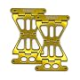

# Speed By Design Gold Aluminum Saddlebag Lid Stoppers for Harley-Davidson Touring Models Compatible with 2014-2025, Replaces Flimsy OEM Straps, Made in USA, Not for 2013 and Earlier

[Home](../README.md) · [All parts A–Z](../PARTS_INDEX.md) · [System](../systems/body.md)

| Field | Record |
| --- | --- |
| Status | Delivered |
| Quantity | 1  |
| Part number | Not confirmed |
| Order / source | Amazon 111-0239862-6179411 |
| Documentation checked | 2026-10-23 |

## Product and installation documents

- [Ordered product listing](https://www.amazon.com/dp/B0FJTYP22N?ref_=pe_148126100_1193965070_i_fed_asin_title)
- An exact public installation manual was not located. Obtain the product-specific instructions from the manufacturer or use the applicable Harley service procedure for OEM replacement parts.

## Build notes

- Historical order evidence; installation not established.

## Evidence

- Gmail message 19f4d0c6512d4dab; order reference Amazon 111-0239862-6179411

## Builder record

- [ ] Received and box label matched
- [ ] Hardware and instructions present
- [ ] Installed / retained / superseded decision recorded
- [ ] Function checked

Installed date: __________  Technician: __________

Notes: ____________________________________________________
