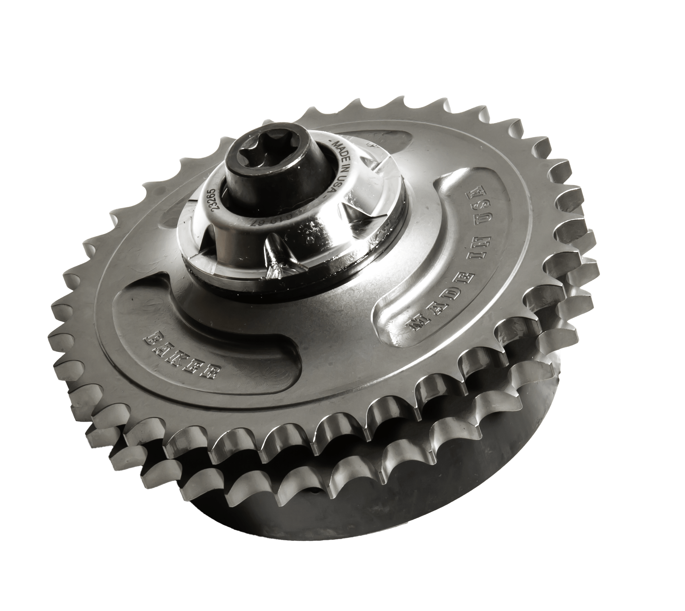

# 34 Tooth Compensator Sprocket Kit, M8 Models

[All parts](../README.md) · [System](../systems/primary.md)

*Photo: Manufacturer product photograph; used for both current M8 variant listings.*

| Field | Record |
| --- | --- |
| Status | Shipped |
| Quantity | 1  |
| Part number | 730-M8 |
| Part-number evidence | Order / packing-slip evidence |
| Order / source | BAKER 32687 / shipment S51407 |
| Order date | 2026-10-20 |
| Documentation checked | 2026-10-23 |

## Product and installation documents

- [Product reference](https://bakerdrivetrain.com/products/m8-compensator-sprocket?variant=29560699650126)
- [Prior inventory reference (may illustrate product family)](https://bakerdrivetrain.com/products/m8-compensator-sprocket)
- [BAKER 730-67 / 730-M8 installation instructions](https://cdn.shopify.com/s/files/1/1034/8027/files/Compensating_Sprocket_Instructions_PV5-121105.pdf?v=1618502420) — PDF
- [Downloaded PDF copy: BAKER 730-67 / 730-M8 installation instructions](../manuals/baker-comp-a8c267fc.pdf)

## Build notes

- Corrected model confirmed by packing slip and owner. Previous Softail wording superseded; do not reopen.
- The owner confirmed the order was corrected to the proper Touring version. Old Shop variant label is superseded.
- Manufacturer names 730-M8 for 2017-later Touring.
- 617-67 spring-pack spacer is explicitly excluded from the M8 kit.
- Use included shims as required by measured chain alignment; refer to factory instructions for installation and torque.

## Kit / assembly itemization

Components are grouped with this product. Separately indexed equipment and assembly references are not additional purchases. Read each row’s inclusion note.

| Included component | Quantity | Part number | Reference | Inclusion / identification note |
| --- | --- | --- | --- | --- |
| 9/16-12 bolt | 1 | 10500031 | [Kit/manual parts reference](https://cdn.shopify.com/s/files/1/1034/8027/files/Compensating_Sprocket_Instructions_PV5-121105.pdf?v=1618502420#page=3) |  |
| Compensator retainer | 1 | 619-67 | [Kit/manual parts reference](https://cdn.shopify.com/s/files/1/1034/8027/files/Compensating_Sprocket_Instructions_PV5-121105.pdf?v=1618502420#page=3) |  |
| Thrust washer | 1 | BD-40100064 | [Kit/manual parts reference](https://cdn.shopify.com/s/files/1/1034/8027/files/Compensating_Sprocket_Instructions_PV5-121105.pdf?v=1618502420#page=3) |  |
| 34-tooth sprocket | 1 | 621-67F | [Kit/manual parts reference](https://cdn.shopify.com/s/files/1/1034/8027/files/Compensating_Sprocket_Instructions_PV5-121105.pdf?v=1618502420#page=3) |  |
| Motor extension shaft | 1 | 722-67 | [Kit/manual parts reference](https://cdn.shopify.com/s/files/1/1034/8027/files/Compensating_Sprocket_Instructions_PV5-121105.pdf?v=1618502420#page=3) |  |
| 2 x 31 mm Buna O-ring | 1 | 9262K682 | [Kit/manual parts reference](https://cdn.shopify.com/s/files/1/1034/8027/files/Compensating_Sprocket_Instructions_PV5-121105.pdf?v=1618502420#page=3) |  |
| Cam slider | 1 | 623-67-4 | [Kit/manual parts reference](https://cdn.shopify.com/s/files/1/1034/8027/files/Compensating_Sprocket_Instructions_PV5-121105.pdf?v=1618502420#page=3) |  |
| Belleville spring | 4 | 620-67 | [Kit/manual parts reference](https://cdn.shopify.com/s/files/1/1034/8027/files/Compensating_Sprocket_Instructions_PV5-121105.pdf?v=1618502420#page=3) |  |
| Spring retainer | 1 | 624-67-4 | [Kit/manual parts reference](https://cdn.shopify.com/s/files/1/1034/8027/files/Compensating_Sprocket_Instructions_PV5-121105.pdf?v=1618502420#page=3) |  |
| 0.030 inch shim | 1 | 3088A438 | [Kit/manual parts reference](https://cdn.shopify.com/s/files/1/1034/8027/files/Compensating_Sprocket_Instructions_PV5-121105.pdf?v=1618502420#page=3) |  |
| 0.020 inch shim | 1 | 3088A388 | [Kit/manual parts reference](https://cdn.shopify.com/s/files/1/1034/8027/files/Compensating_Sprocket_Instructions_PV5-121105.pdf?v=1618502420#page=3) |  |
| 0.010 inch shim | 1 | 3088A328 | [Kit/manual parts reference](https://cdn.shopify.com/s/files/1/1034/8027/files/Compensating_Sprocket_Instructions_PV5-121105.pdf?v=1618502420#page=3) |  |

**Kit documentation gap:** Some internal parts have only an illustrated kit/manual reference; separate retail listings or service SKUs were not verified. Do not treat a parent-kit link as a standalone component offer.

## Evidence

- Gmail message 1a15f7638759019e; order reference BAKER 32687 / shipment S51407
- Public source: https://bakerdrivetrain.com/products/m8-compensator-sprocket
- Public source: https://cdn.shopify.com/s/files/1/1034/8027/files/Compensating_Sprocket_Instructions_PV5-121105.pdf?v=1618502420
- Prior project inventory: Street_Glide_Master_Parts.xlsx, October 20, 2026, worksheet row 25.

## Builder record

- [ ] Received and box label matched
- [ ] Hardware and instructions present
- [ ] Installed / retained / superseded decision recorded
- [ ] Function checked

Installed date: __________  Technician: __________

Notes: ____________________________________________________
