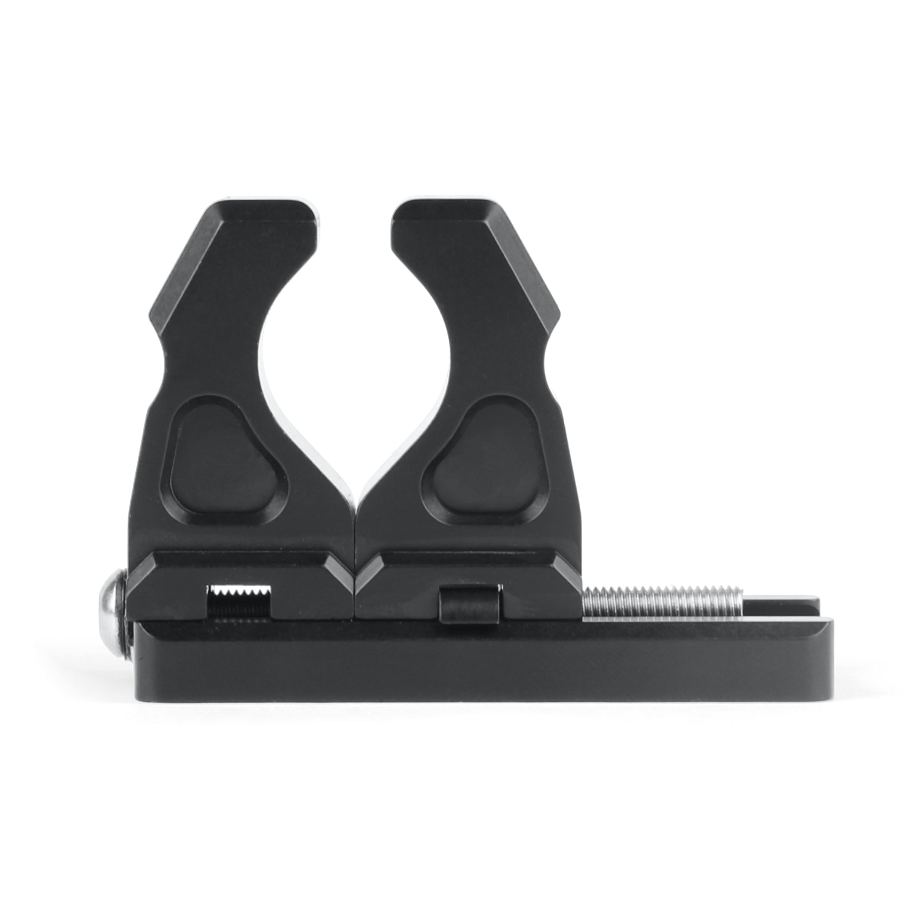

# Low-Profile Bar Clamps

[All parts](../README.md) · [System](../systems/accessories.md)

| Field | Record |
| --- | --- |
| Status | Delivered |
| Quantity | 2  |
| Part number | Not confirmed |
| Order / source | NVMOS; Shop history |
| Order date | 2026-05-07 |
| Documentation checked | 2026-10-23 |

## Product and installation documents

- [Product reference](https://hondogarage.com/products/low-profile-bar-clamps)
- [Official bar clamp installation guide](https://hondogarage.com/blogs/install-guides/bar-clamp-system-how-to-use) — HTML/video guide

## Evidence

- Shop order 019e0429-e61c-7eae-b556-966f9d0d906f; 2026-05-07

## Builder record

- [ ] Received and box label matched
- [ ] Hardware and instructions present
- [ ] Installed / retained / superseded decision recorded
- [ ] Function checked

Installed date: __________  Technician: __________

Notes: ____________________________________________________
