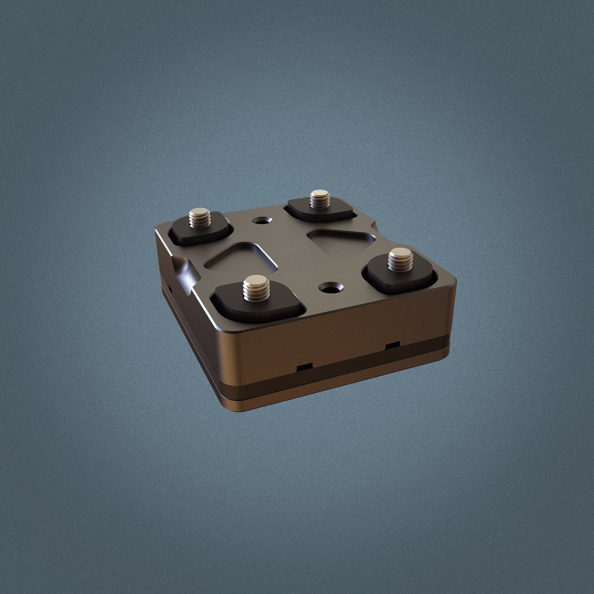

# BuzzKill2.0 - Phone (Perfect Squeeze) — Phone (Perfect Squeeze)

[All parts](../README.md) · [System](../systems/accessories.md)

| Field | Record |
| --- | --- |
| Status | Delivered |
| Quantity | 2  |
| Part number | Not confirmed |
| Order / source | NVMOS; Shop history |
| Order date | 2026-05-07 |
| Documentation checked | 2026-10-23 |

## Product and installation documents

- [Product reference](https://hondogarage.com/products/buzzkill2-0-legacy)
- [Official BuzzKill2.0 installation guide](https://hondogarage.com/blogs/install-guides/buzzkill2-0-install-guide) — HTML installation guide

## Build notes

- Ordered before Gen 3 release; order calls it BuzzKill2.0 and uses BK2_assembled image. Current /buzzkill2-0 URL describes Gen 3; use Gen 2 legacy listing.
- Both ordered units are Phone (Perfect Squeeze), not Tablet.

## Evidence

- Shop order 019e0429-e61c-7eae-b556-966f9d0d906f; 2026-05-07

## Builder record

- [ ] Received and box label matched
- [ ] Hardware and instructions present
- [ ] Installed / retained / superseded decision recorded
- [ ] Function checked

Installed date: __________  Technician: __________

Notes: ____________________________________________________
