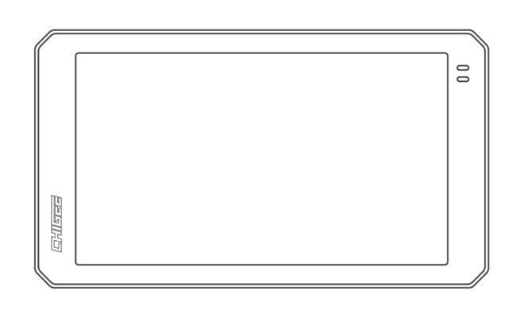

# CHIGEE AIO-6 LTE 4G Smart Riding Display

[Home](../README.md) · [All parts A–Z](../PARTS_INDEX.md) · [System](../systems/electronics.md)

*Photo: Manufacturer manual photo of the AIO-6 LTE display.*

| Field | Record |
| --- | --- |
| Status | Installed — owner reported |
| Quantity | 1  |
| Part number | MFP0170 |
| Part-number evidence | Manufacturer catalog match; verify received part label |
| Order / source | Owner-confirmed installed equipment |
| Variant | AIO-6 LTE; base package |
| Documentation checked | 2026-10-23 |

## Product and installation documents

- [Product reference](https://www.chigee.com/products/aio-6-lte)
- [Official AIO-6 LTE user manual and installation guide](https://www.chigee.com/pages/manual-for-aio6-lte) — Read; includes illustrated package list, mounting, power, accessories, setup

## Build notes

- Package inventory comes from the manufacturer's current LTE manual, not a guessed bundle.
- Cameras, radar, TPMS, wireless remote and quick-release module are separate accessories; retain separately confirmed owned/ordered rows and do not count them as base-box contents.
- Use CHIGEE main harness; manufacturer prohibits third-party cables at the main harness port. Route for full steering movement and secure waterproof connectors per the manual.
- Power wiring and accessory setup must follow the full manual. A U3-class microSD card is specified for recording; a microSD is not in the listed base kit.
- Mounting bracket range is 22–32mm; evaluate with the chosen Kraus bar/risers and the separately owned quick-release parts.

## Kit / assembly itemization

Components are grouped with this product. Separately indexed equipment and assembly references are not additional purchases. Read each row’s inclusion note.

| Included component | Quantity | Part number | Reference | Inclusion / identification note |
| --- | --- | --- | --- | --- |
| AIO-6 LTE display | 1 | Not published | [Parent product / kit reference](https://www.chigee.com/products/aio-6-lte) | Included in base kit, not an additional owned unit. |
| 17mm ball head | 1 | Not published | [Kit/manual parts reference](https://www.chigee.com/pages/manual-for-aio6-lte) | Exact included item pictured in manufacturer manual; no separately orderable product page verified. |
| Type-C main harness | 1 | Not published | [Kit/manual parts reference](https://www.chigee.com/pages/manual-for-aio6-lte) | Exact included item pictured in manufacturer manual; no separately orderable product page verified. |
| Reducer-ring set (22mm, 25mm, 28mm) | 1 | Not published | [Kit/manual parts reference](https://www.chigee.com/pages/manual-for-aio6-lte) | One set containing the three reducer sizes shown in the manual. |
| 22–32mm mounting bracket | 1 | Not published | [Kit/manual parts reference](https://www.chigee.com/pages/manual-for-aio6-lte) | Exact included item pictured in manufacturer manual; no separately orderable product page verified. |
| Power cable | 1 | SH0023 | [Kit/manual parts reference](https://www.chigee.com/products/power-cable) | Included in base kit, not an additional owned unit. |
| Nylon cable ties | 5 | Not published | [Kit/manual parts reference](https://www.chigee.com/pages/manual-for-aio6-lte) | Exact included item pictured in manufacturer manual; no separately orderable product page verified. |
| Disassembly tools | 3 | Not published | [Kit/manual parts reference](https://www.chigee.com/pages/manual-for-aio6-lte) | Exact included item pictured in manufacturer manual; no separately orderable product page verified. |
| Hook-and-loop cable ties | 2 | Not published | [Kit/manual parts reference](https://www.chigee.com/pages/manual-for-aio6-lte) | Exact included item pictured in manufacturer manual; no separately orderable product page verified. |
| Splicing buckles | 2 | Not published | [Kit/manual parts reference](https://www.chigee.com/pages/manual-for-aio6-lte) | Exact included item pictured in manufacturer manual; no separately orderable product page verified. |
| Stickers | 2 | Not published | [Kit/manual parts reference](https://www.chigee.com/pages/manual-for-aio6-lte) | Exact included item pictured in manufacturer manual; no separately orderable product page verified. |

### Component photographs

AIO-6 LTE display — manufacturer reference image.

17mm ball head — manufacturer reference image.

Type-C main harness — manufacturer reference image.

Reducer-ring set (22mm, 25mm, 28mm) — manufacturer reference image.

22–32mm mounting bracket — manufacturer reference image.

Power cable — manufacturer reference image.

Nylon cable ties — manufacturer reference image.

Disassembly tools — manufacturer reference image.

Hook-and-loop cable ties — manufacturer reference image.

Splicing buckles — manufacturer reference image.

Stickers — manufacturer reference image.

**Kit documentation gap:** Some internal parts have only an illustrated kit/manual reference; separate retail listings or service SKUs were not verified. Do not treat a parent-kit link as a standalone component offer.

## Evidence

- Owner conversation history; installed state reported by owner.
- Public source: https://www.chigee.com/products/aio-6-lte
- Public source: https://www.chigee.com/pages/manual-for-aio6-lte
- Public source: https://www.chigee.com/products/power-cable
- Prior project inventory: Street_Glide_Master_Parts.xlsx, October 20, 2026, worksheet row 33.

## Builder record

- [ ] Received and box label matched
- [ ] Hardware and instructions present
- [ ] Installed / retained / superseded decision recorded
- [ ] Function checked

Installed date: __________  Technician: __________

Notes: ____________________________________________________
