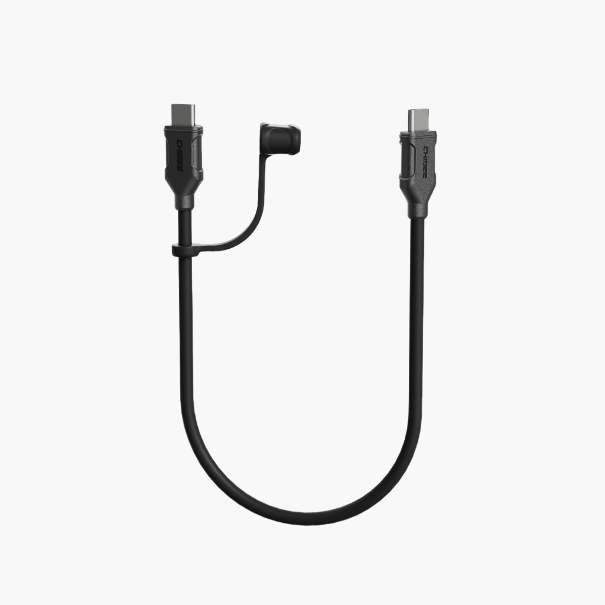

# Gift: Fast Charging Cable For TR100/CG2 - Type-C — Type-C

[Home](../README.md) · [All parts A–Z](../PARTS_INDEX.md) · [System](../systems/electronics.md)

| Field | Record |
| --- | --- |
| Status | Delivered |
| Quantity | 1  |
| Part number | MFP0095 (current retail Type-C equivalent; order is gift variant) |
| Part-number evidence | Manufacturer catalog match; verify received part label |
| Order / source | CHIGEE; Shop history |
| Order date | 2026-05-24 |
| Documentation checked | 2026-10-23 |

## Product and installation documents

- [Product reference](https://www.chigee.com/products/fast-charging-data-cable-for-tr100)
- [TR100 manual](https://drive.google.com/file/d/10R5Cp9_uu9BwoziLMwB-lArByEeikX-e/view?usp=sharing) — Parent-device manual

## Evidence

- Shop order 019e5c3c-1949-7b91-9f93-590890c2f818; 2026-05-24

## Builder record

- [ ] Received and box label matched
- [ ] Hardware and instructions present
- [ ] Installed / retained / superseded decision recorded
- [ ] Function checked

Installed date: __________  Technician: __________

Notes: ____________________________________________________
