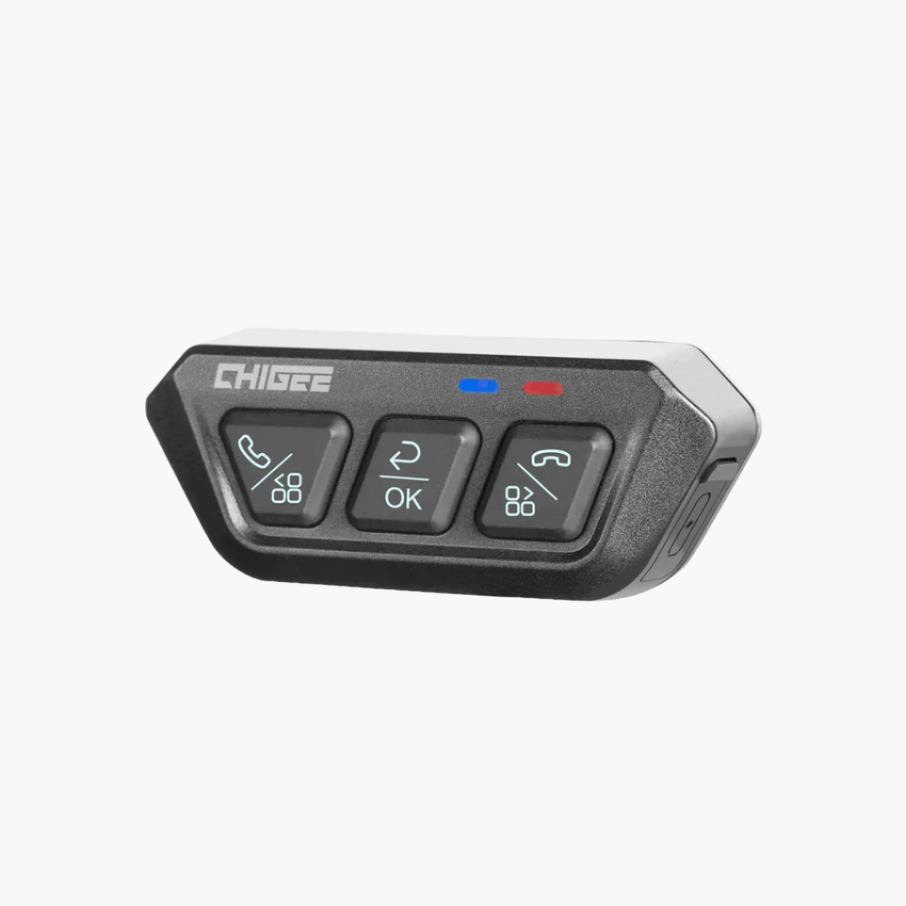

# CGRC Pro Wireless Remote - For CHIGEE Displays

[All parts](../README.md) · [System](../systems/electronics.md)

| Field | Record |
| --- | --- |
| Status | Delivered |
| Quantity | 1  |
| Part number | MFP0089 |
| Part-number evidence | Manufacturer catalog match; verify received part label |
| Order / source | CHIGEE; Shop history |
| Order date | 2026-05-24 |
| Documentation checked | 2026-10-23 |

## Product and installation documents

- [Product reference](https://www.chigee.com/products/mfp0089?variant=47555186655537&_gsid=VLktWKwBvwr1&utm_source=shopify&utm_medium=catalog)
- [Official MFP0089 CGRC Pro manual](https://drive.google.com/file/d/1GJbWUIm9fF45kRBibqAfbbasS2zgK86k/view?usp=sharing) — Manufacturer-linked PDF

## Build notes

- Do not apply additional screw adhesive to plastic CGRC Pro components (manufacturer product guidance).

## Evidence

- Shop order 019e5c3c-1949-7b91-9f93-590890c2f818; 2026-05-24

## Builder record

- [ ] Received and box label matched
- [ ] Hardware and instructions present
- [ ] Installed / retained / superseded decision recorded
- [ ] Function checked

Installed date: __________  Technician: __________

Notes: ____________________________________________________
