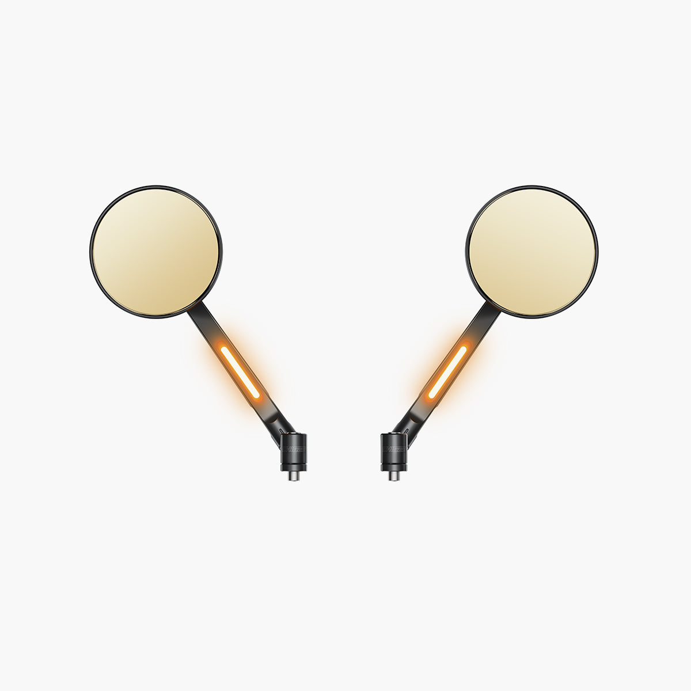

# CG Radar Rearview Mirror - Round Shape — Round Shape

[Home](../README.md) · [All parts A–Z](../PARTS_INDEX.md) · [System](../systems/electronics.md)

| Field | Record |
| --- | --- |
| Status | Delivered |
| Quantity | 1  |
| Part number | Not confirmed |
| Order / source | CHIGEE; Shop history |
| Order date | 2026-05-24 |
| Documentation checked | 2026-10-23 |

## Product and installation documents

- [Product reference](https://www.chigee.com/products/cg-bsd-rearview-mirror?variant=53473491681585&_gsid=VLktWKwBvwr1&utm_source=shopify&utm_medium=catalog)
- [Official product installation FAQ](https://www.chigee.com/products/cg-bsd-rearview-mirror) — Product installation guidance

## Build notes

- Requires M10 mirror mounting holes; compatibility with chosen Harley controls/mount adapters must be established.
- Connect mirror harnesses to SR-1 main harness; integrated indicators replace separate SR-1 indicators.

## Kit / assembly itemization

Components are grouped with this product. Separately indexed equipment and assembly references are not additional purchases. Read each row’s inclusion note.

| Included component | Quantity | Part number | Reference | Inclusion / identification note |
| --- | --- | --- | --- | --- |
| Left round rearview mirror | 1 | Not published | Separate component page not located; see parent kit/manual | Separate component page not located; see parent kit/manual |
| Right round rearview mirror | 1 | Not published | Separate component page not located; see parent kit/manual | Separate component page not located; see parent kit/manual |
| 6 mm spacer | 2 | Not published | Separate component page not located; see parent kit/manual | Separate component page not located; see parent kit/manual |
| M10 x 35 P1.50 right-hand bolt | 2 | Not published | Separate component page not located; see parent kit/manual | Separate component page not located; see parent kit/manual |
| M10 x 35 P1.25 right-hand bolt | 2 | Not published | Separate component page not located; see parent kit/manual | Separate component page not located; see parent kit/manual |
| M10 x 35 P1.25 left-hand bolt | 1 | Not published | Separate component page not located; see parent kit/manual | Separate component page not located; see parent kit/manual |
| Silicone cable tie | 2 | Not published | Separate component page not located; see parent kit/manual | Separate component page not located; see parent kit/manual |

**Kit documentation gap:** Some internal parts have only an illustrated kit/manual reference; separate retail listings or service SKUs were not verified. Do not treat a parent-kit link as a standalone component offer.

## Evidence

- Shop order 019e5c3c-1949-7b91-9f93-590890c2f818; 2026-05-24

## Builder record

- [ ] Received and box label matched
- [ ] Hardware and instructions present
- [ ] Installed / retained / superseded decision recorded
- [ ] Function checked

Installed date: __________  Technician: __________

Notes: ____________________________________________________
