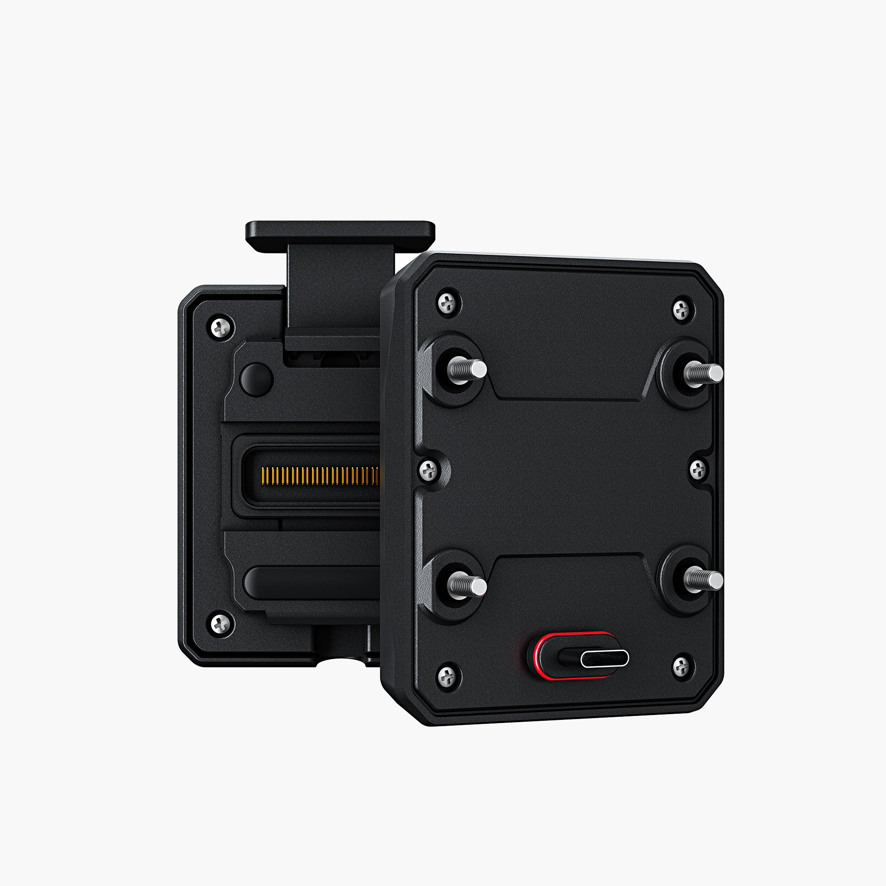

# CG Quick-Release Module for AIO-6 Series

[Home](../README.md) · [All parts A–Z](../PARTS_INDEX.md) · [System](../systems/electronics.md)

| Field | Record |
| --- | --- |
| Status | Delivered |
| Quantity | 1  |
| Part number | Not confirmed |
| Order / source | CHIGEE; Shop history |
| Order date | 2026-05-24 |
| Documentation checked | 2026-10-23 |

## Product and installation documents

- [Product reference](https://www.chigee.com/products/cg-quick-release-module?variant=50798667563313&_gsid=VLktWKwBvwr1&utm_source=shopify&utm_medium=catalog)
- [Official CG Quick-Release manual](https://www.chigee.com/pages/manual-for-cg-quick-release) — HTML manual

## Build notes

- Contents wording follows product page; manual labels sides differently. Use physical assembly diagram.
- This order establishes the mount; the AIO-6 LTE display is separately confirmed by the October 20 owner inventory.
- Direct vehicle power; not USB-powered.

## Kit / assembly itemization

Components are grouped with this product. Separately indexed equipment and assembly references are not additional purchases. Read each row’s inclusion note.

| Included component | Quantity | Part number | Reference | Inclusion / identification note |
| --- | --- | --- | --- | --- |
| CG Quick-Release Module, bike side | 1 | Not published | Separate component page not located; see parent kit/manual | Separate component page not located; see parent kit/manual |
| CG Quick-Release Base, display side | 1 | Not published | Separate component page not located; see parent kit/manual | Separate component page not located; see parent kit/manual |
| Dustproof/waterproof cover | 1 | Not published | Separate component page not located; see parent kit/manual | Separate component page not located; see parent kit/manual |
| Installation tools | 3 | Not published | Separate component page not located; see parent kit/manual | Separate component page not located; see parent kit/manual |
| Locking screw tool | 1 | Not published | Separate component page not located; see parent kit/manual | Separate component page not located; see parent kit/manual |

**Kit documentation gap:** Some internal parts have only an illustrated kit/manual reference; separate retail listings or service SKUs were not verified. Do not treat a parent-kit link as a standalone component offer.

## Evidence

- Shop order 019e5c3c-1949-7b91-9f93-590890c2f818; 2026-05-24

## Builder record

- [ ] Received and box label matched
- [ ] Hardware and instructions present
- [ ] Installed / retained / superseded decision recorded
- [ ] Function checked

Installed date: __________  Technician: __________

Notes: ____________________________________________________
