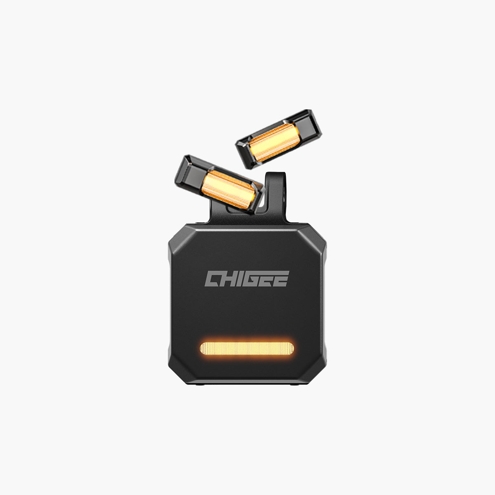

# SR-1 Millimeter-wave Radar System - 77GHz radar — 77GHz radar

[All parts](../README.md) · [System](../systems/electronics.md)

| Field | Record |
| --- | --- |
| Status | Delivered |
| Quantity | 1  |
| Part number | MFP0216 |
| Part-number evidence | Manufacturer catalog match; verify received part label |
| Order / source | CHIGEE; Shop history |
| Order date | 2026-05-24 |
| Documentation checked | 2026-10-23 |

## Product and installation documents

- [Product reference](https://www.chigee.com/products/sr1?variant=53513094758705&_gsid=VLktWKwBvwr1&utm_source=shopify&utm_medium=catalog)
- [Official SR-1 user and installation manual](https://www.chigee.com/pages/manual-for-sr1) — HTML manual

## Build notes

- Can use the ordered radar mirrors instead of the included separate indicator lamps.

## Kit / assembly itemization

Components are grouped with this product. Separately indexed equipment and assembly references are not additional purchases. Read each row’s inclusion note.

| Included component | Quantity | Part number | Reference | Inclusion / identification note |
| --- | --- | --- | --- | --- |
| Radar module with bracket | 1 | Not published | Separate component page not located; see parent kit/manual | Separate component page not located; see parent kit/manual |
| Blind spot warning light | 2 | Not published | [Component product / service reference](https://www.chigee.com/products/indicator-light-for-sr-1-radar-single) | Verified manufacturer replacement page |
| Warning-light bracket | 2 | Not published | Separate component page not located; see parent kit/manual | Separate component page not located; see parent kit/manual |
| Main wiring harness | 1 | Not published | [Component product / service reference](https://www.chigee.com/products/sr-1-power-cable) | Verified manufacturer replacement page |
| Torx key | 2 | Not published | Separate component page not located; see parent kit/manual | Separate component page not located; see parent kit/manual |
| 3M adhesive | 1 | Not published | Separate component page not located; see parent kit/manual | Separate component page not located; see parent kit/manual |
| ACC wire tap clip | 2 | Not published | Separate component page not located; see parent kit/manual | Separate component page not located; see parent kit/manual |
| Cable tie | 5 | Not published | Separate component page not located; see parent kit/manual | Separate component page not located; see parent kit/manual |
| Long silicone cable tie | 2 | Not published | Separate component page not located; see parent kit/manual | Separate component page not located; see parent kit/manual |
| Short silicone cable tie | 2 | Not published | Separate component page not located; see parent kit/manual | Separate component page not located; see parent kit/manual |

**Kit documentation gap:** Some internal parts have only an illustrated kit/manual reference; separate retail listings or service SKUs were not verified. Do not treat a parent-kit link as a standalone component offer.

## Evidence

- Shop order 019e5c3c-1949-7b91-9f93-590890c2f818; 2026-05-24

## Builder record

- [ ] Received and box label matched
- [ ] Hardware and instructions present
- [ ] Installed / retained / superseded decision recorded
- [ ] Function checked

Installed date: __________  Technician: __________

Notes: ____________________________________________________
