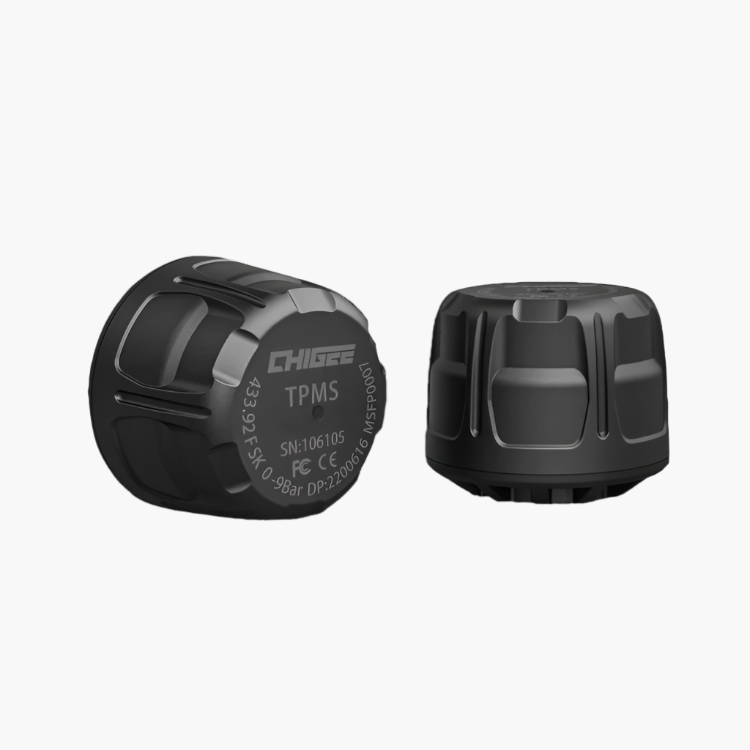

# External Tire Pressure Sensors - Pair (a set) — Pair (a set)

[Home](../README.md) · [All parts A–Z](../PARTS_INDEX.md) · [System](../systems/electronics.md)

| Field | Record |
| --- | --- |
| Status | Delivered |
| Quantity | 1  |
| Part number | MFP0019 |
| Part-number evidence | Manufacturer catalog match; verify received part label |
| Order / source | CHIGEE; Shop history |
| Order date | 2026-05-24 |
| Documentation checked | 2026-10-23 |

## Product and installation documents

- [Product reference](https://www.chigee.com/products/tire-pressure?variant=48306817761585&_gsid=VLktWKwBvwr1&utm_source=shopify&utm_medium=catalog)
- [Official MFP0019 external TPMS manual](https://drive.google.com/file/d/13hdhzUbGvLlWCSZ_p-bdLM0EDAFuy8dX/view?usp=sharing) — Manufacturer-linked PDF

## Build notes

- Check valve-stem and brake-caliper clearance.

## Kit / assembly itemization

Components are grouped with this product. Separately indexed equipment and assembly references are not additional purchases. Read each row’s inclusion note.

| Included component | Quantity | Part number | Reference | Inclusion / identification note |
| --- | --- | --- | --- | --- |
| External tire pressure sensor | 2 | Not published | Separate component page not located; see parent kit/manual | Separate component page not located; see parent kit/manual |

**Kit documentation gap:** Some internal parts have only an illustrated kit/manual reference; separate retail listings or service SKUs were not verified. Do not treat a parent-kit link as a standalone component offer.

## Evidence

- Shop order 019e5c3c-1949-7b91-9f93-590890c2f818; 2026-05-24

## Builder record

- [ ] Received and box label matched
- [ ] Hardware and instructions present
- [ ] Installed / retained / superseded decision recorded
- [ ] Function checked

Installed date: __________  Technician: __________

Notes: ____________________________________________________
