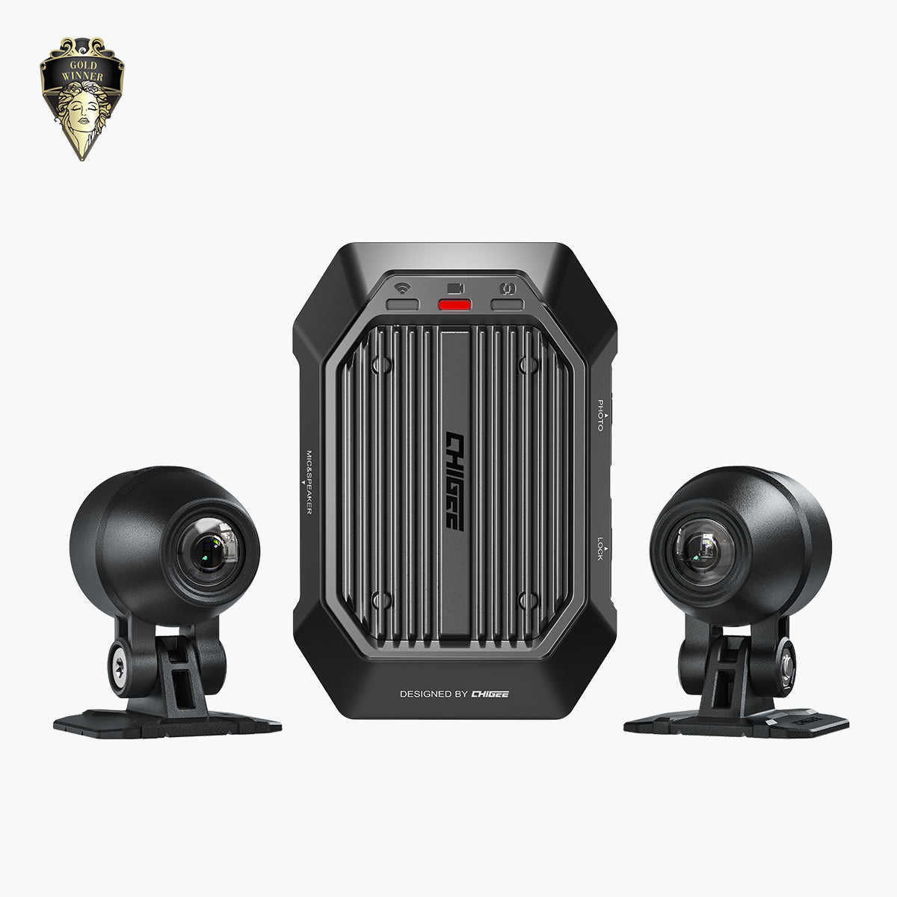

# XR-1 Discreet Motorcycle Dash Cam

[All parts](../README.md) · [System](../systems/electronics.md)

| Field | Record |
| --- | --- |
| Status | Delivered |
| Quantity | 1  |
| Part number | MFP0232 |
| Part-number evidence | Manufacturer catalog match; verify received part label |
| Order / source | CHIGEE; Shop history |
| Order date | 2026-06-03 |
| Documentation checked | 2026-10-23 |

## Product and installation documents

- [Product reference](https://www.chigee.com/products/xr-1?variant=54216160084273&_gsid=VLktWKwBvwr1&utm_source=shopify&utm_medium=catalog)
- [Official XR-1 installation and user manual](https://www.chigee.com/pages/manual-for-xr1-dashcam) — HTML manual

## Build notes

- Separate SD card and optional GNSS controller are not established as purchased by this order.

## Kit / assembly itemization

Components are grouped with this product. Separately indexed equipment and assembly references are not additional purchases. Read each row’s inclusion note.

| Included component | Quantity | Part number | Reference | Inclusion / identification note |
| --- | --- | --- | --- | --- |
| XR-1 host | 1 | Not published | Separate component page not located; see parent kit/manual | Separate component page not located; see parent kit/manual |
| Camera | 2 | Not published | Separate component page not located; see parent kit/manual | Separate component page not located; see parent kit/manual |
| Camera clamp | 2 | Not published | Separate component page not located; see parent kit/manual | Separate component page not located; see parent kit/manual |
| Camera base | 2 | Not published | Separate component page not located; see parent kit/manual | Separate component page not located; see parent kit/manual |
| Power cable | 1 | Not published | Separate component page not located; see parent kit/manual | Separate component page not located; see parent kit/manual |
| Cable clip | 2 | Not published | Separate component page not located; see parent kit/manual | Separate component page not located; see parent kit/manual |
| Removal tool | 2 | Not published | Separate component page not located; see parent kit/manual | Separate component page not located; see parent kit/manual |
| Velcro strap | 2 | Not published | Separate component page not located; see parent kit/manual | Separate component page not located; see parent kit/manual |
| Nylon cable tie | 5 | Not published | Separate component page not located; see parent kit/manual | Separate component page not located; see parent kit/manual |
| 3M adhesive | 4 | Not published | Separate component page not located; see parent kit/manual | Separate component page not located; see parent kit/manual |
| CHIGEE sticker | 1 | Not published | Separate component page not located; see parent kit/manual | Separate component page not located; see parent kit/manual |

**Kit documentation gap:** Some internal parts have only an illustrated kit/manual reference; separate retail listings or service SKUs were not verified. Do not treat a parent-kit link as a standalone component offer.

## Evidence

- Shop order 019e8f44-645c-72b6-91df-151febf75d0a; 2026-06-03

## Builder record

- [ ] Received and box label matched
- [ ] Hardware and instructions present
- [ ] Installed / retained / superseded decision recorded
- [ ] Function checked

Installed date: __________  Technician: __________

Notes: ____________________________________________________
