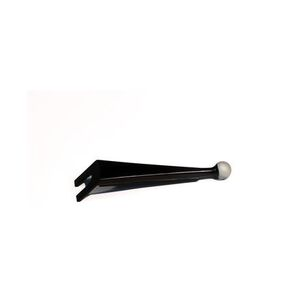

# Fairing Mount For Harley Touring 2014-2018

[All parts](../README.md) · [System](../systems/accessories.md)

| Field | Record |
| --- | --- |
| Status | Delivered |
| Quantity | 2  |
| Part number | 50117 |
| Part-number evidence | Manufacturer catalog match; verify received part label |
| Order / source | J&P Cycles 56596640 |
| Order date | 2026-06-03 |
| Documentation checked | 2026-10-23 |

## Product and installation documents

- [Product reference](https://ciro3d.com/products/ciro-ball-fairing-mount)
- [Accessory Fairing Mount, G0050116, Rev. B](https://cdn.shopify.com/s/files/1/0069/5064/9956/files/G0050116_Fairing_Mount_REV_B-01.pdf) — Downloaded and visually verified
- [Downloaded PDF copy: Accessory Fairing Mount, G0050116, Rev. B](../manuals/ciro-mount-15ebdf48.pdf)

## Build notes

- Black; June6 delivery email located.
- Current manufacturer listing covers 2014–2023 SKU 50117.
- Mount has 5/8-inch ball; compatible with Ciro original and GEN 2 accessories.
- Official installation sheet places mount at center windshield bolt between windshield and inner fairing; T27 Torx.
- Quantity two is supported by order description. This is a center mounting position: do not assume both can be fitted simultaneously; confirm intended allocation.
- Product-only mount: device holder or cup holder not established as included.
- Manual specifically warns against overtightening the windshield bolt and stripping the brass insert. Use factory service guidance for the vehicle fastener.

## Kit / assembly itemization

Components are grouped with this product. Separately indexed equipment and assembly references are not additional purchases. Read each row’s inclusion note.

| Included component | Quantity | Part number | Reference | Inclusion / identification note |
| --- | --- | --- | --- | --- |
| Accessory fairing mount | Not published | Not published | [Parent product / kit reference](https://ciro3d.com/products/ciro-ball-fairing-mount) | Complete unit |

**Kit documentation gap:** Some internal parts have only an illustrated kit/manual reference; separate retail listings or service SKUs were not verified. Do not treat a parent-kit link as a standalone component offer.

## Evidence

- Gmail message 19e8eb85823ef757; order reference J&P Cycles 56596640
- Public source: https://ciro3d.com/products/ciro-ball-fairing-mount
- Public source: https://ciro3d.com/products/ciro-ball-fairing-mount.json
- Public source: https://www.jpcycles.com/product/ciro-fairing-mount-for-harley-touring-2014-2016

## Builder record

- [ ] Received and box label matched
- [ ] Hardware and instructions present
- [ ] Installed / retained / superseded decision recorded
- [ ] Function checked

Installed date: __________  Technician: __________

Notes: ____________________________________________________
