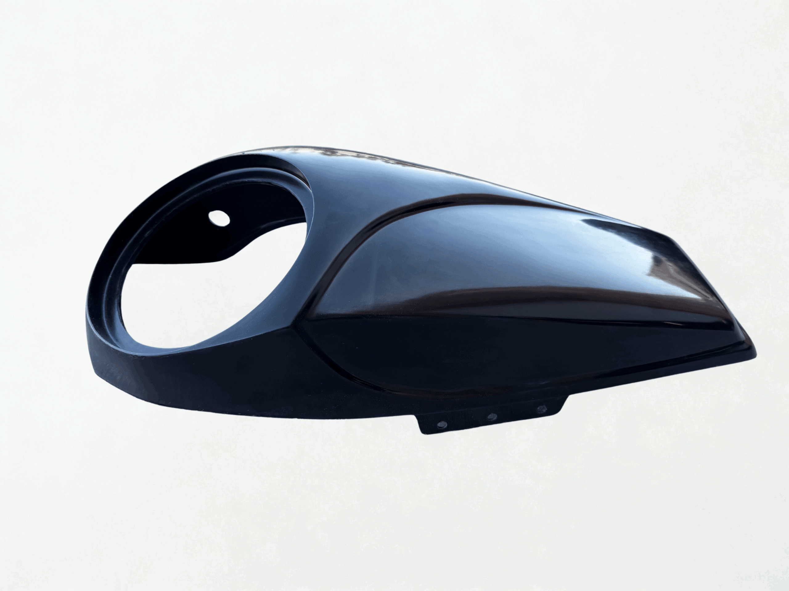

# V2 8" Audio Speaker Lids 2024+ Model

[All parts](../README.md) · [System](../systems/audio.md)

| Field | Record |
| --- | --- |
| Status | Order completed |
| Quantity | 1  |
| Part number | DBC359-1 |
| Part-number evidence | DBC359 order; manufacturer base/no-premium package catalog code DBC359-1 |
| Order / source | Dirty Bird db-50925 |
| Order date | 2026-07-03 |
| Documentation checked | 2026-10-23 |

## Product and installation documents

- [Product reference](https://dirtybirdconcepts.com/products/dbc359-harley-davidson-v2-8-audio-speaker-lids-2024-model)
- [Manufacturer instructions](https://dirtybirdconcepts.com/products/dbc359-harley-davidson-v2-8-audio-speaker-lids-2024-model) — No standalone installation manual found
- [Manufacturer instructions](https://www.youtube.com/watch?v=BOBxkriUJu0) — Linked on product page; not verified as full install tutorial

## Build notes

- Order completed July7. Model entered 2025 Street Glide; premium Cicada audio NOT included.
- Sold unpainted; material described as NYB polymer/urethane.
- Uses factory hardware. Hardware is not established as included.
- Advertised for 2024+ bag shape; verify against the actual replacement bags supplied for this 2018 project, not stock 2018 bag assumptions.
- Manufacturer says fits nearly any 8-inch speaker; check actual speaker depth, grille clearance, sealing, and lid/bag interface before paint.
- Not included: Speakers, Amplifier, Speaker grilles, Optional premium audio package: CXX8.4 pair, HD-FLX-RO, CBG8F pair, FLX700.4
- October 20 inventory also reports existing Dirty Bird lids but does not identify their model. DBC359 is the documented July purchase; whether the current lids are that exact pair needs box/part comparison. The older inventory picture depicts a different Twisted8 reference and is not used for this order.

## Kit / assembly itemization

Components are grouped with this product. Separately indexed equipment and assembly references are not additional purchases. Read each row’s inclusion note.

| Included component | Quantity | Part number | Reference | Inclusion / identification note |
| --- | --- | --- | --- | --- |
| Left non-tweeter 8-inch speaker lid | 1 | Not published | [Parent product / kit reference](https://dirtybirdconcepts.com/products/dbc359-harley-davidson-v2-8-audio-speaker-lids-2024-model) | Only pair sold on verified product page |
| Right non-tweeter 8-inch speaker lid | 1 | Not published | [Parent product / kit reference](https://dirtybirdconcepts.com/products/dbc359-harley-davidson-v2-8-audio-speaker-lids-2024-model) | Only pair sold on verified product page |

**Kit documentation gap:** Some internal parts have only an illustrated kit/manual reference; separate retail listings or service SKUs were not verified. Do not treat a parent-kit link as a standalone component offer.

## Evidence

- Gmail message 19f298fb4795bf4a; order reference Dirty Bird db-50925
- Public source: https://dirtybirdconcepts.com/products/dbc359-harley-davidson-v2-8-audio-speaker-lids-2024-model
- Public source: https://dirtybirdconcepts.com/products/dbc359-harley-davidson-v2-8-audio-speaker-lids-2024-model.json
- Prior project inventory: Street_Glide_Master_Parts.xlsx, October 20, 2026, worksheet row 38.

## Builder record

- [ ] Received and box label matched
- [ ] Hardware and instructions present
- [ ] Installed / retained / superseded decision recorded
- [ ] Function checked

Installed date: __________  Technician: __________

Notes: ____________________________________________________
