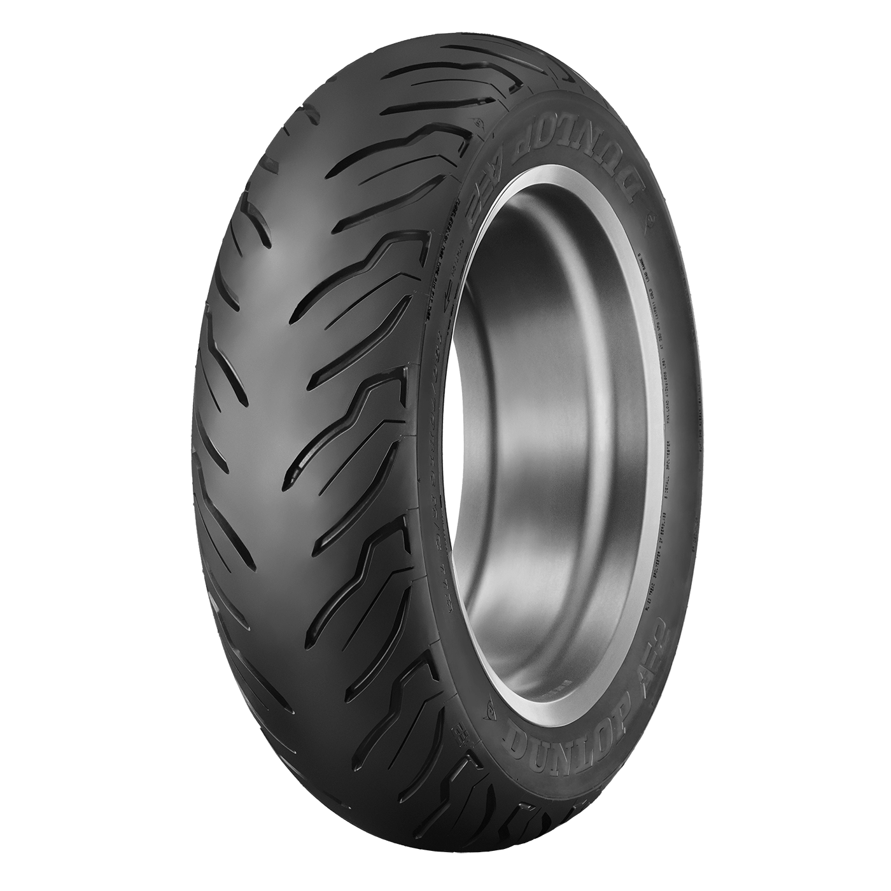

# Dunlop AE2 rear tire

[Home](../README.md) · [All parts A–Z](../PARTS_INDEX.md) · [System](../systems/wheels-tires.md)

*Photo: Manufacturer AE2 rear family product image served by Dunlop's mirrored manufacturer site at dmt.exults.com; illustrates tread, not verification of the owner's sidewall markings.*

| Field | Record |
| --- | --- |
| Status | Installed — owner reported |
| Quantity | 1  |
| Part number | 45252462 |
| Part-number evidence | Manufacturer catalog match; verify received part label |
| Order / source | Owner-confirmed installed equipment |
| Variant | 180/65B16 81H; blackwall |
| Documentation checked | 2026-10-23 |

## Product and installation documents

- [Product reference](https://www.dunlopmotorcycletires.com/tire-line/ae2/)
- [Prior inventory reference (may illustrate product family)](https://dmt.exults.com/tire-line/ae2/)
- [Dunlop motorcycle tire care, installation and mounting guidance](https://www.dunlopmotorcycletires.com/about/care/) — Manufacturer general tire guidance; not an AE2-specific service manual.
- [Dunlop tire care page mirror](https://dmt.exults.com/about/care/) — Search-readable copy of same manufacturer care content; main domain has an access challenge.

## Build notes

- Size and load/speed code reported in owner master inventory. Manufacturer's AE2 size table matches this part number.
- Preserve front/rear positions and inspect actual sidewall model, size, direction, date code and condition.
- Use vehicle/tire manufacturer service guidance for mounting, pressure and load; a table's maximum-load-at-pressure figure is not a prescribed riding pressure.

## Evidence

- Owner conversation history; installed state reported by owner.
- Public source: https://www.dunlopmotorcycletires.com/tire-line/ae2/
- Public source: https://dmt.exults.com/tire-line/ae2/
- Public source: https://www.dunlopmotorcycletires.com/about/care/
- Prior project inventory: Street_Glide_Master_Parts.xlsx, October 20, 2026, worksheet row 31.

## Builder record

- [ ] Received and box label matched
- [ ] Hardware and instructions present
- [ ] Installed / retained / superseded decision recorded
- [ ] Function checked

Installed date: __________  Technician: __________

Notes: ____________________________________________________
