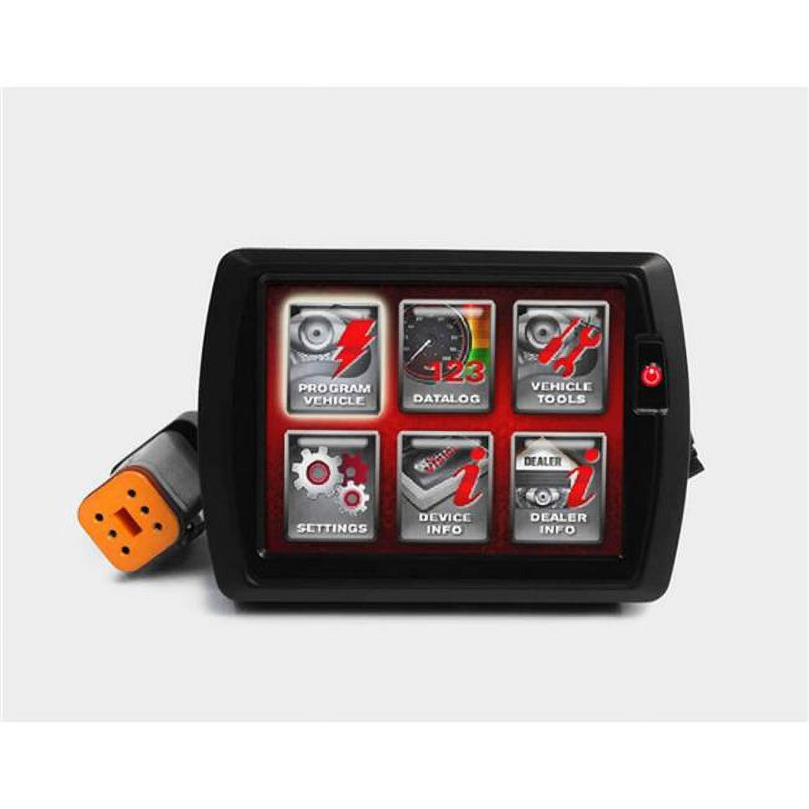

# Power Vision Black Series Fuel Tuner for Harley Davidson CAN ECU

[Home](../README.md) · [All parts A–Z](../PARTS_INDEX.md) · [System](../systems/engine.md)

| Field | Record |
| --- | --- |
| Status | Delivered |
| Quantity | 1  |
| Part number | PV-2B |
| Part-number evidence | Order / packing-slip evidence |
| Order / source | Walmart 2000153-04403753 |
| Order date | 2026-07-28 |
| Documentation checked | 2026-10-23 |

## Product and installation documents

- [Product reference](https://www.dynojet.com/harley-davidson-power-vision-delphi-can-black-1/)
- [Power Vision Quick Start Guide 98100014.12](https://www.dynojet.com/amfile/file/download/file/67/product/4506/) — Exact product page download
- [Power Vision / WinPV full user guide](https://www.dynojet.com/amfile/file/download/file/71/product/4506/) — Exact product page download
- [Current Power Vision Harley downloads](https://www.dynojet.com/downloads/power-vision-for-harley-davidson/) — Product-family software and documents
- [Downloaded PDF copy: Power Vision Quick Start Guide 98100014.12](../manuals/dynojet-pv2b-df7dd70f.pdf)
- [Downloaded PDF copy: Power Vision / WinPV full user guide](../manuals/dynojet-pv2b-3fdb819a.pdf)

## Build notes

- Historical order is PV-2B. Owner later mentioned Power Vision 4; do not silently merge those model identities.
- The July Gmail order confirms PV-2B; the October 20 owner inventory separately confirms a Power Vision 4. Keep both records; do not assume the older PV-2B remains in use.
- Factory product fitment includes 2018 FLHX Street Glide.
- Record current calibration and VIN license before engine work; the 129 build needs a calibration for its final measured combination.

## Kit / assembly itemization

Components are grouped with this product. Separately indexed equipment and assembly references are not additional purchases. Read each row’s inclusion note.

| Included component | Quantity | Part number | Reference | Inclusion / identification note |
| --- | --- | --- | --- | --- |
| Power Vision unit | 1 | Not published | [Kit/manual parts reference](https://www.dynojet.com/amfile/file/download/file/67/product/4506/) | Manufacturer kit inventory; standalone sale link not verified |
| Vehicle diagnostic cable | 1 | Not published | [Kit/manual parts reference](https://www.dynojet.com/amfile/file/download/file/67/product/4506/) | Manufacturer kit inventory; standalone sale link not verified |
| USB cable | 1 | Not published | [Kit/manual parts reference](https://www.dynojet.com/amfile/file/download/file/67/product/4506/) | Manufacturer kit inventory; standalone sale link not verified |
| Six-inch cable ties | 4 | Not published | [Kit/manual parts reference](https://www.dynojet.com/amfile/file/download/file/67/product/4506/) | Manufacturer kit inventory; standalone sale link not verified |
| M4 x 0.7 x 8 mm mounting bolts and washers | 4 | Not published | [Kit/manual parts reference](https://www.dynojet.com/amfile/file/download/file/67/product/4506/) | Manufacturer kit inventory; standalone sale link not verified |
| Quick start guide | 1 | Not published | [Kit/manual parts reference](https://www.dynojet.com/amfile/file/download/file/67/product/4506/) | Manufacturer kit inventory; standalone sale link not verified |

**Kit documentation gap:** Some internal parts have only an illustrated kit/manual reference; separate retail listings or service SKUs were not verified. Do not treat a parent-kit link as a standalone component offer.

## Evidence

- Gmail message 19faa9fa5f60ed36; order reference Walmart 2000153-04403753
- Gmail message 19facbc488297398; order reference Walmart 2000153-04403753
- Gmail message 19fbbb899c8fb141; order reference Walmart 2000153-04403753

## Builder record

- [ ] Received and box label matched
- [ ] Hardware and instructions present
- [ ] Installed / retained / superseded decision recorded
- [ ] Function checked

Installed date: __________  Technician: __________

Notes: ____________________________________________________
