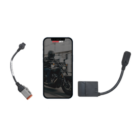

# Dynojet Power Vision 4

[Home](../README.md) · [All parts A–Z](../PARTS_INDEX.md) · [System](../systems/engine.md)

| Field | Record |
| --- | --- |
| Status | Owned — current inventory |
| Quantity | 1  |
| Part number | Not confirmed |
| Part-number evidence | PV4 family confirmed; PV4-15-02 is catalog fitment only, not verified device label |
| Order / source | Owner-confirmed owned tuning device |
| Documentation checked | 2026-10-23 |

## Product and installation documents

- [Product reference](https://www.dynojet.com/power-vision-4-for-2011-2020-harley-davidson-1/)
- [Prior inventory reference (may illustrate product family)](https://www.dynojet.com/pv4/)
- [Power Vision 4 installation guide 98200143.04](https://www.dynojet.com/installguide/PV4-15-02) — Official guide for PV4-15-01, PV4-15-02 and PV4-15-03; owner unit part number unrecorded
- [Power Vision 4 user guide](https://www.dynojet.com/amfile/file/download/file/11792/product/182075/) — Official product-family guide linked by PV4-15-02 product page
- [Downloaded PDF copy: Power Vision 4 installation guide 98200143.04](../manuals/dynojet-pv4-92396165.pdf)
- [Downloaded PDF copy: Power Vision 4 user guide](../manuals/dynojet-pv4-4a5f6ae3.pdf)

## Build notes

- Product family ownership is confirmed. Photo and product link show PV4-15-02, the catalog match for a 2018 FLHX, not a verified photographed owner unit.
- Confirm the device label, vehicle license and current calibration with the builder. The separately documented PV-2B purchase is an earlier different tuner.
- Product page and guide describe the PV4 Bluetooth device, mobile app and one included tune license. A detailed box bill of materials was not found; accessory ownership is not established.

## Kit / assembly itemization

Components are grouped with this product. Separately indexed equipment and assembly references are not additional purchases. Read each row’s inclusion note.

| Included component | Quantity | Part number | Reference | Inclusion / identification note |
| --- | --- | --- | --- | --- |
| Power Vision 4 Bluetooth tuning device | 1 | Not published | [Parent product / kit reference](https://www.dynojet.com/power-vision-4-for-2011-2020-harley-davidson-1/) | Confirmed owned product family; exact physical kit SKU unrecorded |
| Included tune license | 1 | Not published | [Kit/manual parts reference](https://www.dynojet.com/installguide/PV4-15-02) | Factory package feature; verify present license status rather than count as an unused owner entitlement |

**Kit documentation gap:** Some internal parts have only an illustrated kit/manual reference; separate retail listings or service SKUs were not verified. Do not treat a parent-kit link as a standalone component offer.

## Evidence

- October 20 owner inventory; owned tuning device, not proof of a completed calibration.
- Prior project inventory: Street_Glide_Master_Parts.xlsx, October 20, 2026, worksheet row 21.

## Builder record

- [ ] Received and box label matched
- [ ] Hardware and instructions present
- [ ] Installed / retained / superseded decision recorded
- [ ] Function checked

Installed date: __________  Technician: __________

Notes: ____________________________________________________
