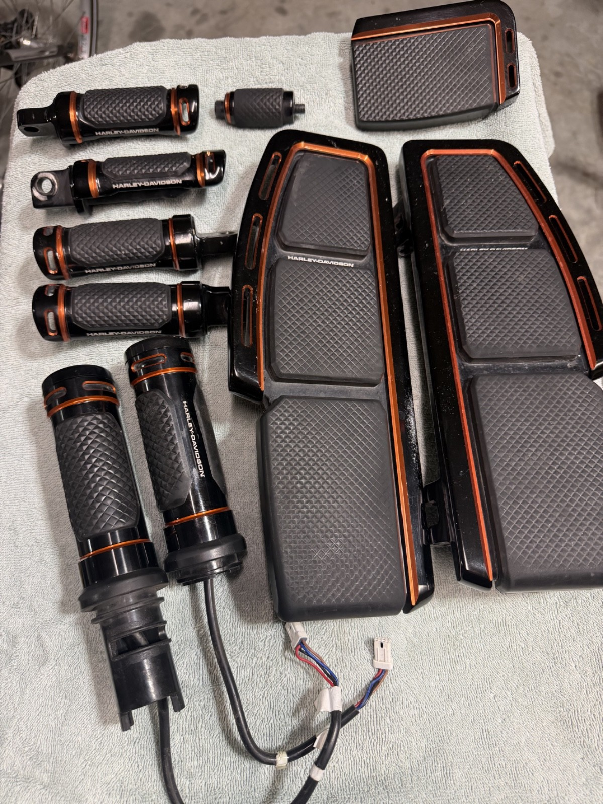

# NEW Harley Adversary Rider Footboard Peg Shifter Brake Pedal Pad Kit Set, Orange

[Home](../README.md) · [All parts A–Z](../PARTS_INDEX.md) · [System](../systems/controls.md)

| Field | Record |
| --- | --- |
| Status | Delivered |
| Quantity | Not established  |
| Part number | Not confirmed |
| Order / source | eBay 16-14957-18888 |
| Order date | 2026-07-31 |
| Documentation checked | 2026-10-23 |

## Product and installation documents

- [Ordered product listing](https://www.ebay.com/itm/137537266261)
- [J06775 Rider Footboard – Touring](https://serviceinfo.harley-davidson.com/sip/service/document/2173438860103712441) — Use ONLY if board kit label is 50502251 (no A suffix); purchased kit SKU not verified
- [94100550 Rider Footboard – Touring](https://serviceinfo.harley-davidson.com/sip/service/document-pdf-print/1930317604344918427/351590/94100550_1903350_en_US.xml) — Use ONLY if board kit label is 50502251A; purchased kit SKU not verified

Purchased listing recorded; exact unit count was not recoverable from the order excerpt. Verify received quantity.

## Build notes

- Historic purchase evidence; current installation state not established. Listing wording preserved.
- One listing/order line; quantity not printed in email.
- eBay item 137537266261 redirects to https://www.ebay.com/p/8067717934, a generic Adversary footboard catalog; it is not the original kit listing.
- Do not assign component SKUs from a similar current kit or from the generic footboard catalog.
- Confirm packaging/part numbers, counts, and peg mounting type before selecting final installation sheets.
- Official H-D documents list different board procedures for original 50502251 and revised 50502251A; reference links supplied conditionally, not as proven exact manuals.

## Kit / assembly itemization

Components are grouped with this product. Separately indexed equipment and assembly references are not additional purchases. Read each row’s inclusion note.

| Included component | Quantity | Part number | Reference | Inclusion / identification note |
| --- | --- | --- | --- | --- |
| Rider footboard component(s) | Not published | Not published | [Parent product / kit reference](https://www.ebay.com/itm/137537266261) | Exact SKU and quantity unverified; obtain label or original listing |
| Peg component(s) | Not published | Not published | [Parent product / kit reference](https://www.ebay.com/itm/137537266261) | Exact SKU, count and passenger/highway type unverified |
| Shifter component(s) | Not published | Not published | [Parent product / kit reference](https://www.ebay.com/itm/137537266261) | Exact SKU and quantity unverified |
| Brake pedal pad | Not published | Not published | [Parent product / kit reference](https://www.ebay.com/itm/137537266261) | Exact SKU and quantity unverified |

**Kit documentation gap:** Some internal parts have only an illustrated kit/manual reference; separate retail listings or service SKUs were not verified. Do not treat a parent-kit link as a standalone component offer.

## Evidence

- Gmail message 19fb6a15507a517d; order reference eBay 16-14957-18888
- Gmail message 19fc88c4a49a2d71; order reference eBay 16-14957-18888
- Public source: https://www.ebay.com/itm/137537266261
- Public source: https://www.ebay.com/p/8067717934
- Public source: https://serviceinfo.harley-davidson.com/sip/service/document/2173438860103712441

## Builder record

- [ ] Received and box label matched
- [ ] Hardware and instructions present
- [ ] Installed / retained / superseded decision recorded
- [ ] Function checked

Installed date: __________  Technician: __________

Notes: ____________________________________________________
