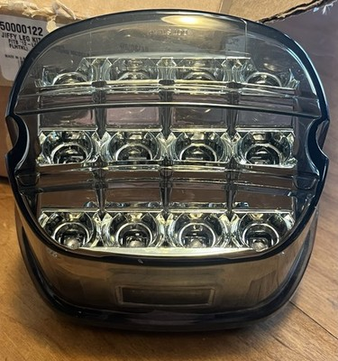

# Harley-Davidson Smoked Layback LED Tail Lamp Assembly #67800356

[All parts](../README.md) · [System](../systems/lighting.md)

| Field | Record |
| --- | --- |
| Status | Delivered |
| Quantity | Not established  |
| Part number | 67800356 |
| Part-number evidence | Order / packing-slip evidence |
| Order / source | eBay 05-14914-68667 |
| Order date | 2026-07-16 |
| Documentation checked | 2026-10-23 |

## Product and installation documents

- [Ordered product listing](https://www.ebay.com/itm/158033404860)
- [Harley J05758 — layback LED tail lamp](https://serviceinfo.harley-davidson.com/sip/service/document/1874968971159028097?locale=en_US) — Official instruction sheet matched to ordered kit number.

Purchased listing recorded; exact unit count was not recoverable from the order excerpt. Verify received quantity.

## Build notes

- Historic purchase evidence; current installation state not established. Listing wording preserved.
- One listing/order line; quantity not printed in email.

## Kit / assembly itemization

Components are grouped with this product. Separately indexed equipment and assembly references are not additional purchases. Read each row’s inclusion note.

| Included component | Quantity | Part number | Reference | Inclusion / identification note |
| --- | --- | --- | --- | --- |
| LED tail lamp / lens assembly | 1 | Not published | [Official illustrated parts reference](https://serviceinfo.harley-davidson.com/sip/service/document/1874968971159028097?locale=en_US) | Service part listed in the kit instruction sheet; separate retail page not located. |
| Jumper harness | Not published | 69200905 | [Official illustrated parts reference](https://serviceinfo.harley-davidson.com/sip/service/document/1874968971159028097?locale=en_US) | Service part listed in the kit instruction sheet; separate retail page not located. |
| Four-way housing | Not published | 73154-96BK | [Official illustrated parts reference](https://serviceinfo.harley-davidson.com/sip/service/document/1874968971159028097?locale=en_US) | Service part listed in the kit instruction sheet; separate retail page not located. |
| Dielectric grease | Not published | 76001-04 | [Official illustrated parts reference](https://serviceinfo.harley-davidson.com/sip/service/document/1874968971159028097?locale=en_US) | Service part listed in the kit instruction sheet; separate retail page not located. |

**Kit documentation gap:** Individual part numbers and counts are preserved from official instructions. Links open the illustrated kit parts list because individual purchase pages were not verified.

## Evidence

- Gmail message 19f6c5088cc04b94; order reference eBay 05-14914-68667
- Gmail message 19f8b667ae8308fa; order reference eBay 05-14914-68667

## Builder record

- [ ] Received and box label matched
- [ ] Hardware and instructions present
- [ ] Installed / retained / superseded decision recorded
- [ ] Function checked

Installed date: __________  Technician: __________

Notes: ____________________________________________________
