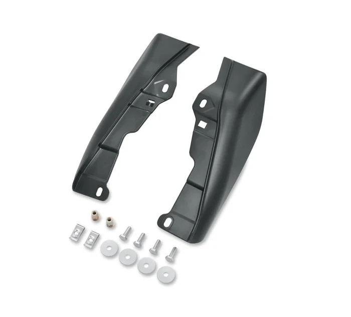

# Harley-Davidson 58002-09A Mid-Frame Air Deflector

[Home](../README.md) · [All parts A–Z](../PARTS_INDEX.md) · [System](../systems/body.md)

| Field | Record |
| --- | --- |
| Status | Delivered |
| Quantity | Not established  |
| Part number | 58002-09A |
| Part-number evidence | Order / packing-slip evidence |
| Order / source | eBay 07-14963-38178 |
| Order date | 2026-07-28 |
| Documentation checked | 2026-10-23 |

## Product and installation documents

- [Ordered product listing](https://www.ebay.com/itm/206288535714)
- [Harley J04715 — mid-frame air deflectors](https://serviceinfo.harley-davidson.com/sip/service/document/1981471649719306699) — Official instruction sheet matched to ordered kit number.

Purchased listing recorded; exact unit count was not recoverable from the order excerpt. Verify received quantity.

## Build notes

- Historic purchase evidence; current installation state not established. Listing wording preserved.
- One listing/order line; quantity not printed in email.

## Kit / assembly itemization

Components are grouped with this product. Separately indexed equipment and assembly references are not additional purchases. Read each row’s inclusion note.

| Included component | Quantity | Part number | Reference | Inclusion / identification note |
| --- | --- | --- | --- | --- |
| Screw | 4 | 3787 | [Official illustrated parts reference](https://serviceinfo.harley-davidson.com/sip/service/document/1981471649719306699) | Service part listed in the kit instruction sheet; separate retail page not located. |
| Washer | 4 | 6036 | [Official illustrated parts reference](https://serviceinfo.harley-davidson.com/sip/service/document/1981471649719306699) | Service part listed in the kit instruction sheet; separate retail page not located. |
| Speed nut | 2 | 8108 | [Official illustrated parts reference](https://serviceinfo.harley-davidson.com/sip/service/document/1981471649719306699) | Service part listed in the kit instruction sheet; separate retail page not located. |
| Special nut | 2 | 8194 | [Official illustrated parts reference](https://serviceinfo.harley-davidson.com/sip/service/document/1981471649719306699) | Service part listed in the kit instruction sheet; separate retail page not located. |
| Right air deflector | 1 | 58167-09A | [Official illustrated parts reference](https://serviceinfo.harley-davidson.com/sip/service/document/1981471649719306699) | Service part listed in the kit instruction sheet; separate retail page not located. |
| Left air deflector | 1 | 58169-09 | [Official illustrated parts reference](https://serviceinfo.harley-davidson.com/sip/service/document/1981471649719306699) | Service part listed in the kit instruction sheet; separate retail page not located. |

**Kit documentation gap:** Individual part numbers and counts are preserved from official instructions. Links open the illustrated kit parts list because individual purchase pages were not verified.

## Evidence

- Gmail message 19faaf0de54f0ec1; order reference eBay 07-14963-38178
- Gmail message 1a0118270901853d; order reference eBay 07-14963-38178

## Builder record

- [ ] Received and box label matched
- [ ] Hardware and instructions present
- [ ] Installed / retained / superseded decision recorded
- [ ] Function checked

Installed date: __________  Technician: __________

Notes: ____________________________________________________
