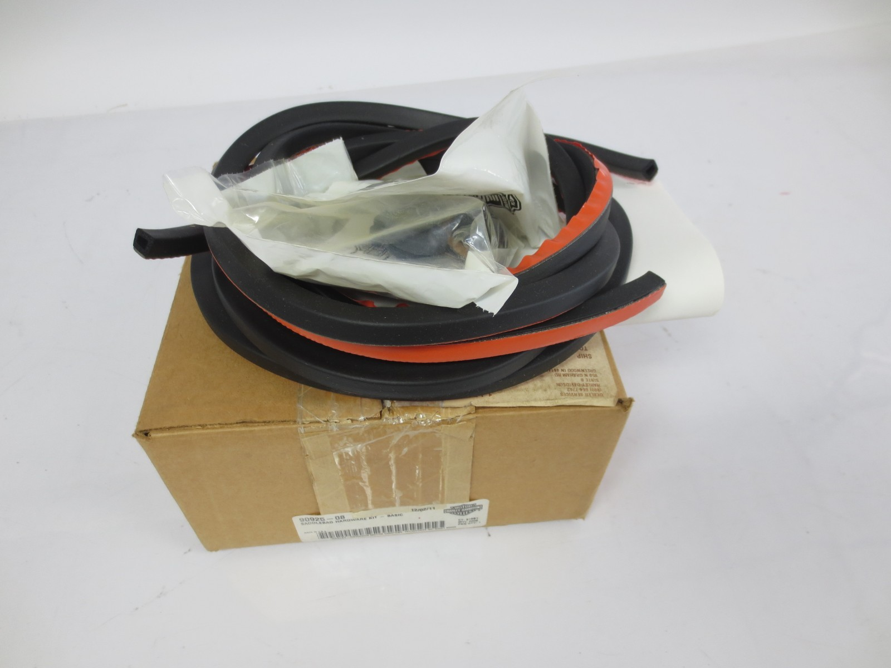

# NEW Genuine Harley-Davidson OEM Saddle Bag Hardware Kit 90925-08

[All parts](../README.md) · [System](../systems/body.md)

| Field | Record |
| --- | --- |
| Status | Delivered |
| Quantity | Not established  |
| Part number | 90925-08 |
| Part-number evidence | Order / packing-slip evidence |
| Order / source | eBay 05-14914-68664 |
| Order date | 2026-07-16 |
| Documentation checked | 2026-10-23 |

## Product and installation documents

- [Ordered product listing](https://www.ebay.com/itm/287292038831)
- [Harley J04644 — saddlebag hardware kit 90925-08](https://serviceinfo.harley-davidson.com/sip/service/document-pdf-print/1874960981727547779/280140/J04644_521261_en_US.xml) — Official instruction sheet matched to ordered kit number.

Purchased listing recorded; exact unit count was not recoverable from the order excerpt. Verify received quantity.

## Build notes

- Historic purchase evidence; current installation state not established. Listing wording preserved.
- One listing/order line; quantity not printed in email.
- Kit 90925-08 is a legacy saddlebag hardware package. Match its parts to the actual CVO-style replacement bags; do not assume every piece applies to the newer bag design.

## Kit / assembly itemization

Components are grouped with this product. Separately indexed equipment and assembly references are not additional purchases. Read each row’s inclusion note.

| Included component | Quantity | Part number | Reference | Inclusion / identification note |
| --- | --- | --- | --- | --- |
| Grommet | 4 | 11464 | [Official illustrated parts reference](https://serviceinfo.harley-davidson.com/sip/service/document-pdf-print/1874960981727547779/280140/J04644_521261_en_US.xml) | Service part listed in the kit instruction sheet; separate retail page not located. |
| Latch screw | 4 | 2524B | [Official illustrated parts reference](https://serviceinfo.harley-davidson.com/sip/service/document-pdf-print/1874960981727547779/280140/J04644_521261_en_US.xml) | Service part listed in the kit instruction sheet; separate retail page not located. |
| Torx screw | 8 | 3592A | [Official illustrated parts reference](https://serviceinfo.harley-davidson.com/sip/service/document-pdf-print/1874960981727547779/280140/J04644_521261_en_US.xml) | Service part listed in the kit instruction sheet; separate retail page not located. |
| Pan-head screw | 10 | 3595 | [Official illustrated parts reference](https://serviceinfo.harley-davidson.com/sip/service/document-pdf-print/1874960981727547779/280140/J04644_521261_en_US.xml) | Service part listed in the kit instruction sheet; separate retail page not located. |
| Screw | 4 | 5233 | [Official illustrated parts reference](https://serviceinfo.harley-davidson.com/sip/service/document-pdf-print/1874960981727547779/280140/J04644_521261_en_US.xml) | Service part listed in the kit instruction sheet; separate retail page not located. |
| Hex nut | 2 | 7608 | [Official illustrated parts reference](https://serviceinfo.harley-davidson.com/sip/service/document-pdf-print/1874960981727547779/280140/J04644_521261_en_US.xml) | Service part listed in the kit instruction sheet; separate retail page not located. |
| Saddlebag gasket | 2 | 90675-93A | [Official illustrated parts reference](https://serviceinfo.harley-davidson.com/sip/service/document-pdf-print/1874960981727547779/280140/J04644_521261_en_US.xml) | Service part listed in the kit instruction sheet; separate retail page not located. |
| Label | 2 | 90820-93C | [Official illustrated parts reference](https://serviceinfo.harley-davidson.com/sip/service/document-pdf-print/1874960981727547779/280140/J04644_521261_en_US.xml) | Service part listed in the kit instruction sheet; separate retail page not located. |
| Wear plate | 4 | 90962-93 | [Official illustrated parts reference](https://serviceinfo.harley-davidson.com/sip/service/document-pdf-print/1874960981727547779/280140/J04644_521261_en_US.xml) | Service part listed in the kit instruction sheet; separate retail page not located. |

**Kit documentation gap:** Individual part numbers and counts are preserved from official instructions. Links open the illustrated kit parts list because individual purchase pages were not verified.

## Evidence

- Gmail message 19f6c5088cc04b94; order reference eBay 05-14914-68664
- Gmail message 19f85956b81999c7; order reference eBay 05-14914-68664

## Builder record

- [ ] Received and box label matched
- [ ] Hardware and instructions present
- [ ] Installed / retained / superseded decision recorded
- [ ] Function checked

Installed date: __________  Technician: __________

Notes: ____________________________________________________
