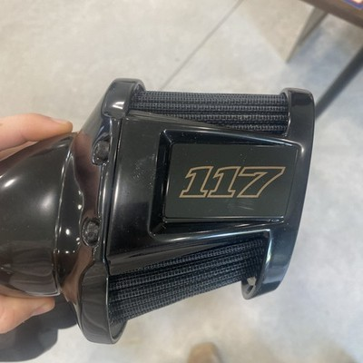

# OEM 2017-2023 Harley-Davidson Screaming Eagl M8 Air Cleaner Breather 117 Touring

[Home](../README.md) · [All parts A–Z](../PARTS_INDEX.md) · [System](../systems/engine.md)

| Field | Record |
| --- | --- |
| Status | Delivered |
| Quantity | Not established  |
| Part number | Not confirmed |
| Order / source | eBay 16-14926-21500 |
| Order date | 2026-07-23 |
| Documentation checked | 2026-10-23 |

## Product and installation documents

- [Ordered product listing](https://www.ebay.com/itm/307073523553)
- [Harley-Davidson instruction-sheet lookup](https://serviceinfo.harley-davidson.com/sip/isheet/lookup) — Lookup reference only, not a verified manual for this listing. Match exact part and applicable 2018 FLHX service procedure.

Purchased listing recorded; exact unit count was not recoverable from the order excerpt. Verify received quantity.

**Documentation note:** Exact item-specific installation sheet not located; lookup link is provided, not asserted to be an installation manual.

## Build notes

- Historic purchase evidence; current installation state not established. Listing wording preserved.
- One listing/order line; quantity not printed in email.

## Evidence

- Gmail message 19f913951cc98d07; order reference eBay 16-14926-21500
- Gmail message 19fab3c793600983; order reference eBay 16-14926-21500

## Builder record

- [ ] Received and box label matched
- [ ] Hardware and instructions present
- [ ] Installed / retained / superseded decision recorded
- [ ] Function checked

Installed date: __________  Technician: __________

Notes: ____________________________________________________
