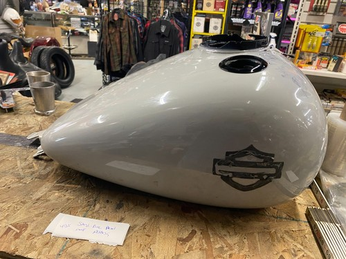

# sand dune pearl harley Gas Fuel tank 2023 Touring STreet Road Glide FLTR FLHX

[All parts](../README.md) · [System](../systems/body.md)

| Field | Record |
| --- | --- |
| Status | Delivered |
| Quantity | Not established  |
| Part number | Not confirmed |
| Order / source | eBay 24-14698-88818 |
| Documentation checked | 2026-10-23 |

## Product and installation documents

- [Ordered product listing](https://www.ebay.com/itm/358446083676)
- [Product reference](https://cyclewarehouse.online/products/sand-dune-pearl-harley-gas-fuel-tank-2023-touring-street-road-glide-fltr-flhx?variant=46981781356706&_gsid=VLktWKwBvwr1&utm_source=shopify&utm_medium=catalog)
- [Harley-Davidson instruction-sheet lookup](https://serviceinfo.harley-davidson.com/sip/isheet/lookup) — Lookup reference only, not a verified manual for this listing. Match exact part and applicable 2018 FLHX service procedure.

Purchased listing recorded; exact unit count was not recoverable from the order excerpt. Verify received quantity.

**Documentation note:** Exact item-specific installation sheet not located; lookup link is provided, not asserted to be an installation manual.

## Build notes

- Historic purchase evidence; current installation state not established. Listing wording preserved.
- One listing/order line; quantity not printed in email.
- Used 2023 Sand Dune Pearl Touring tank per seller. Exact Harley part number not in order.
- Use 2018 Touring OEM service procedures after builder verifies tank/pump/console/hose compatibility.
- eBay and Shop records reconciled as the same purchase, not additional units.

## Evidence

- Gmail message 19e848698d6a5039; order reference eBay 24-14698-88818
- Shop order 019e847b-b1ef-7d41-961b-fddd00623c0e; 2026-05-30

## Builder record

- [ ] Received and box label matched
- [ ] Hardware and instructions present
- [ ] Installed / retained / superseded decision recorded
- [ ] Function checked

Installed date: __________  Technician: __________

Notes: ____________________________________________________
