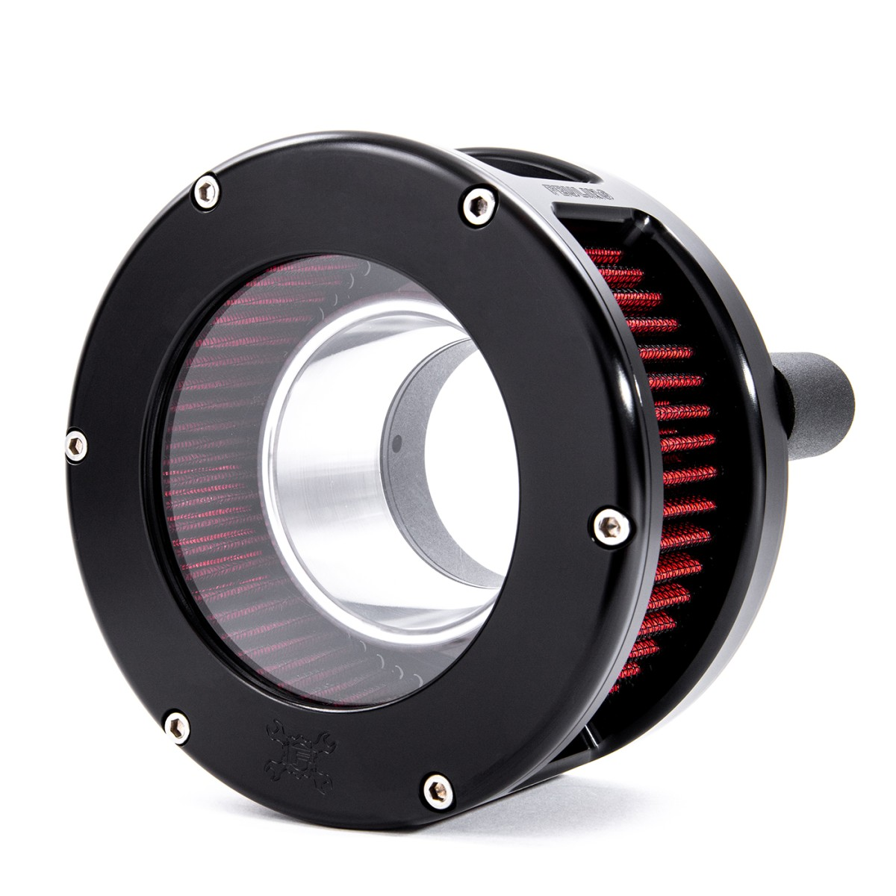

# BA Series Air Cleaner Black With Clear Cover/Red Filter

[All parts](../README.md) · [System](../systems/engine.md)

*Photo: Product/catalog image; inspect supplied hardware and finish against order description.*

| Field | Record |
| --- | --- |
| Status | Shipped |
| Quantity | 1  |
| Part number | 5434 |
| Part-number evidence | Catalog match to ordered description; order email does not print this SKU |
| Order / source | Parts Giant 2132153 |
| Order date | 2026-10-17 |
| Variant | Black; anodized; red cotton gauze; 2018 FLHX fitment on order; shipped Oct19. |
| Documentation checked | 2026-10-23 |

## Product and installation documents

- [Product reference](https://www.partsgiant.com/p408280-feuling-ba-series-air-cleaner-with-clear-cover)
- [Manufacturer product](https://www.feulingparts.com/sku/5434/ba-air-cleaner-kit-black-finish-red-filter)
- [Feuling M-Eight air cleaner installation instructions, includes 5434](https://www.feulingparts.com/tech/installation/instructions/download/5434) — Manufacturer PDF downloaded and text-inspected

## Build notes

- Black; anodized; red cotton gauze; 2018 FLHX fitment on order; shipped Oct19.
- Ordered description matches standard BA 5434; do not substitute a BA Race or closed-cover product.
- Manufacturer specifically lists HPI 58/62mm with the standard M8 air-cleaner bolt pattern.
- Instructions prefer retaining the original throttle-body support bracket; use the described spacer arrangement only if that bracket is removed.
- Optional Feuling external breather kit 5417 is not established as purchased or included.

## Kit / assembly itemization

Components are grouped with this product. Separately indexed equipment and assembly references are not additional purchases. Read each row’s inclusion note.

| Included component | Quantity | Part number | Reference | Inclusion / identification note |
| --- | --- | --- | --- | --- |
| Billet backing plate, black | 1 | Not published | [Parent product / kit reference](https://www.feulingparts.com/sku/5434/ba-air-cleaner-kit-black-finish-red-filter) | No separate backing-plate SKU verified. |
| Billet velocity stack/filter cage, black | 1 | Not published | [Parent product / kit reference](https://www.feulingparts.com/sku/5434/ba-air-cleaner-kit-black-finish-red-filter) | No separate cage SKU verified. |
| Reusable red cotton-gauze filter | 1 | Not published | [Kit/manual parts reference](https://www.partsgiant.com/p408279-feuling-ba-series-air-cleaner-replacement-air-filter-element) | Replacement-filter family listing; select red BA variant. Exact standalone Feuling SKU not verified. |
| Clear air cleaner cover | 1 | Not published | [Parent product / kit reference](https://www.feulingparts.com/sku/5434/ba-air-cleaner-kit-black-finish-red-filter) | No separate clear-cover SKU verified. |
| Breather bolts with inner and outer O-rings | one set | Not published | [Parent product / kit reference](https://www.feulingparts.com/sku/5434/ba-air-cleaner-kit-black-finish-red-filter) | Hardware group shown in installation instructions; individual SKUs not verified. |
| Throttle body gasket | 1 | Not published | [Parent product / kit reference](https://www.feulingparts.com/sku/5434/ba-air-cleaner-kit-black-finish-red-filter) | Individual gasket SKU not verified. |
| Bracket-delete spacers and mounting/cover hardware | one set | Not published | [Parent product / kit reference](https://www.feulingparts.com/sku/5434/ba-air-cleaner-kit-black-finish-red-filter) | Use spacers only as instructed if stock throttle-body bracket is removed; exact hardware sub-SKUs not verified. |

**Kit documentation gap:** Some internal parts have only an illustrated kit/manual reference; separate retail listings or service SKUs were not verified. Do not treat a parent-kit link as a standalone component offer.

## Evidence

- Gmail message 1a1486e18d11946f; order reference Parts Giant 2132153
- Public source: https://www.partsgiant.com/p408280-feuling-ba-series-air-cleaner-with-clear-cover
- Public source: https://www.feulingparts.com/sku/5434/ba-air-cleaner-kit-black-finish-red-filter
- Public source: https://www.feulingparts.com/tech/installation/instructions/download/5434
- Prior project inventory: Street_Glide_Master_Parts.xlsx, October 20, 2026, worksheet row 16.

## Builder record

- [ ] Received and box label matched
- [ ] Hardware and instructions present
- [ ] Installed / retained / superseded decision recorded
- [ ] Function checked

Installed date: __________  Technician: __________

Notes: ____________________________________________________
