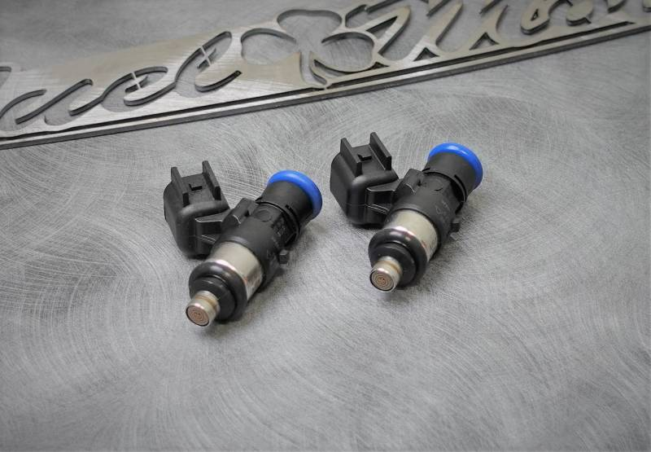

# 6.3 Fuel Injectors

[Home](../README.md) · [All parts A–Z](../PARTS_INDEX.md) · [System](../systems/engine.md)

*Photo: Product/catalog image; inspect supplied hardware and finish against order description.*

| Field | Record |
| --- | --- |
| Status | Shipped |
| Quantity | 1  |
| Part number | FM-INJ-M8-63 |
| Part-number evidence | Order-confirmed SKU |
| Order / source | Fuel Moto 2431652 |
| Order date | 2026-10-17 |
| Variant | Add-on to HPI throttle body. |
| Documentation checked | 2026-10-23 |

## Product and installation documents

- [Product reference](https://www.fuelmotousa.com/i-23898817-fuel-moto-6-3-fuel-injectors-milwaukee-8-harley-davidson.html)
- [Fuel Moto 6.3 g/sec injector product and support reference](https://www.fuelmotousa.com/i-23898817-fuel-moto-6-3-fuel-injectors-milwaukee-8-harley-davidson.html) — No separate installation PDF located; use supplied injector instructions, correct induction procedure and tuner data

## Build notes

- Add-on to HPI throttle body.
- Order-confirmed SKU; specification is 6.3 g/sec at 4 bar.
- Tuner must apply the correct Fuel Moto injector characterization and calibrate the complete 129-inch engine/intake/exhaust combination. Do not infer a finished tune or power figure from the injector listing.

## Kit / assembly itemization

Components are grouped with this product. Separately indexed equipment and assembly references are not additional purchases. Read each row’s inclusion note.

| Included component | Quantity | Part number | Reference | Inclusion / identification note |
| --- | --- | --- | --- | --- |
| Matched Bosch-based 6.3 g/sec injectors | 2 | FM-INJ-M8-63 | [Parent product / kit reference](https://www.fuelmotousa.com/i-23898817-fuel-moto-6-3-fuel-injectors-milwaukee-8-harley-davidson.html) | Sold as a set; individual injector sale SKU not verified. |

**Kit documentation gap:** Some internal parts have only an illustrated kit/manual reference; separate retail listings or service SKUs were not verified. Do not treat a parent-kit link as a standalone component offer.

## Evidence

- Gmail message 1a148638a2cede92; order reference Fuel Moto 2431652
- Public source: https://www.fuelmotousa.com/i-23898817-fuel-moto-6-3-fuel-injectors-milwaukee-8-harley-davidson.html
- Prior project inventory: Street_Glide_Master_Parts.xlsx, October 20, 2026, worksheet row 13.

## Builder record

- [ ] Received and box label matched
- [ ] Hardware and instructions present
- [ ] Installed / retained / superseded decision recorded
- [ ] Function checked

Installed date: __________  Technician: __________

Notes: ____________________________________________________
