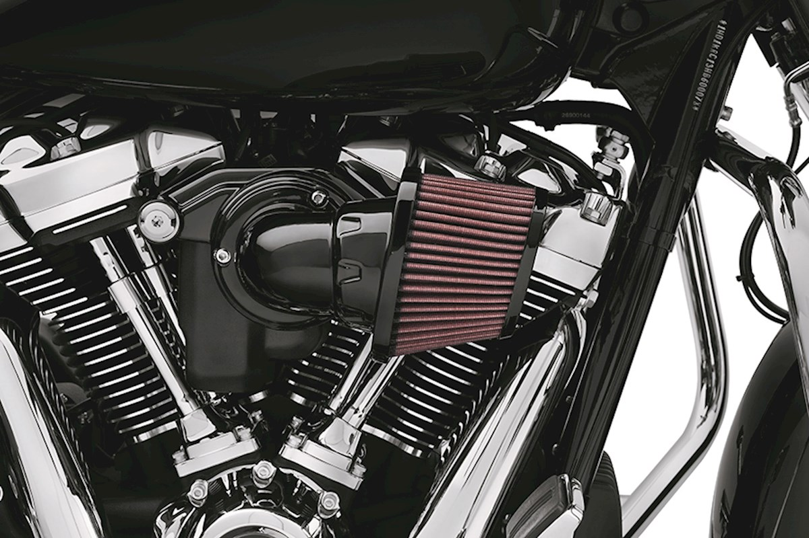

# Harley Screamin’ Eagle Heavy Breather intake with oiled cotton filter

[All parts](../README.md) · [System](../systems/engine.md)

*Photo: Reference model only; exact installed generation/finish is unconfirmed.*

| Field | Record |
| --- | --- |
| Status | Installed — owner reported |
| Quantity | 1  |
| Part number | Not confirmed |
| Order / source | Owner-confirmed installed equipment |
| Documentation checked | 2026-10-23 |

## Product and installation documents

- [Product reference](https://webshop.motorsaloon.nl/en-us/store/29400264-screamin-eagle-heavy-breather-performance-air-cleaner-milwaukee-eight-gloss-black)
- [Prior inventory reference (may illustrate product family)](https://shop.thunderbike.de/en/Harley-Genuine-Parts/SCREAMIN-EAGLE/Air-Cleaner-Kits/Screamin-Eagle-Heavy-Breather-Extreme-Air-Cleaner-chrome.html)
- [J06286 Heavy Breather 29400263 / 29400264 instructions](https://serviceinfo.harley-davidson.com/sip/service/document/1874983031682013569) — Conditional: original M8 kit 29400263 or 29400264 only

## Build notes

- Exact installed generation/finish/SKU not confirmed. Reference product is original M8 black 29400264, not Elite or Extreme.
- Use J06286 parts list only after matching installed intake to 29400263/29400264.
- K&N is filter-media/service-product context from owner; do not assume separate K&N intake kit.
- Reference photo shows an original M8 Heavy Breather 29400264 from an authorized Harley dealer. This is a family reference only; owner installed exact SKU and finish are unrecorded.

## Kit / assembly itemization

Components are grouped with this product. Separately indexed equipment and assembly references are not additional purchases. Read each row’s inclusion note.

| Included component | Quantity | Part number | Reference | Inclusion / identification note |
| --- | --- | --- | --- | --- |
| Screw | 3 | 10500094 | [Kit/manual parts reference](https://serviceinfo.harley-davidson.com/sip/service/document/1874983031682013569) | Manufacturer part-list reference; standalone sale link not verified |
| Intake tube (black reference) | 1 | 29000193 | [Kit/manual parts reference](https://serviceinfo.harley-davidson.com/sip/service/document/1874983031682013569) | Manufacturer part-list reference; standalone sale link not verified |
| Breather screw | 2 | 29400283 | [Kit/manual parts reference](https://serviceinfo.harley-davidson.com/sip/service/document/1874983031682013569) | Manufacturer part-list reference; standalone sale link not verified |
| Gasket | 1 | 29000178 | [Kit/manual parts reference](https://serviceinfo.harley-davidson.com/sip/service/document/1874983031682013569) | Manufacturer part-list reference; standalone sale link not verified |
| O-ring | 2 | 11900040 | [Kit/manual parts reference](https://serviceinfo.harley-davidson.com/sip/service/document/1874983031682013569) | Manufacturer part-list reference; standalone sale link not verified |
| Machined backplate | 1 | Not sold separately | [Kit/manual parts reference](https://serviceinfo.harley-davidson.com/sip/service/document/1874983031682013569) | Manufacturer part-list reference; standalone sale link not verified |
| Square ring | 2 | 11900042 | [Kit/manual parts reference](https://serviceinfo.harley-davidson.com/sip/service/document/1874983031682013569) | Manufacturer part-list reference; standalone sale link not verified |
| Throttle body cover | 1 | 61300616 | [Kit/manual parts reference](https://serviceinfo.harley-davidson.com/sip/service/document/1874983031682013569) | Manufacturer part-list reference; standalone sale link not verified |
| Backplate gasket | 1 | 29000149 | [Kit/manual parts reference](https://serviceinfo.harley-davidson.com/sip/service/document/1874983031682013569) | Manufacturer part-list reference; standalone sale link not verified |
| Two-piece cable strap | 1 | 12500015 | [Kit/manual parts reference](https://serviceinfo.harley-davidson.com/sip/service/document/1874983031682013569) | Manufacturer part-list reference; standalone sale link not verified |
| Self-tapping screw | 3 | 68042-99 | [Kit/manual parts reference](https://serviceinfo.harley-davidson.com/sip/service/document/1874983031682013569) | Manufacturer part-list reference; standalone sale link not verified |
| Button-head screw | 3 | 923 | [Kit/manual parts reference](https://serviceinfo.harley-davidson.com/sip/service/document/1874983031682013569) | Manufacturer part-list reference; standalone sale link not verified |
| Black-trim air cleaner filter kit | 1 | 29400276 | [Kit/manual parts reference](https://serviceinfo.harley-davidson.com/sip/service/document/1874983031682013569) | Manufacturer part-list reference; standalone sale link not verified |
| Rain sock | 1 | 29400318 | [Kit/manual parts reference](https://serviceinfo.harley-davidson.com/sip/service/document/1874983031682013569) | Manufacturer part-list reference; standalone sale link not verified |

**Kit documentation gap:** Exact installed kit is unconfirmed. Component list and instructions describe the cited reference model only; match installed hardware before use.

## Evidence

- Owner conversation history; installed state reported by owner.
- Prior project inventory: Street_Glide_Master_Parts.xlsx, October 20, 2026, worksheet row 17.

## Builder record

- [ ] Received and box label matched
- [ ] Hardware and instructions present
- [ ] Installed / retained / superseded decision recorded
- [ ] Function checked

Installed date: __________  Technician: __________

Notes: ____________________________________________________
