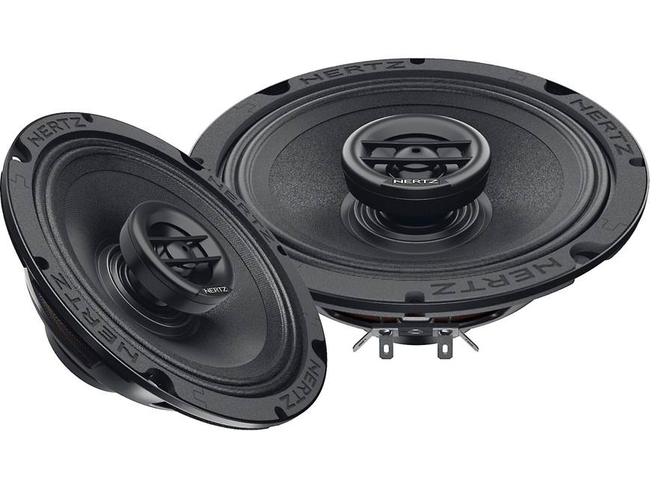

# Hertz SPL Show NEO 6.5-inch speakers (exact model unconfirmed)

[All parts](../README.md) · [System](../systems/audio.md)

*Photo: Prior inventory reference photo of SX 165 NEO family from Crutchfield. Owned SV/SX model and impedance remain unconfirmed; not an owner-unit photograph.*

| Field | Record |
| --- | --- |
| Status | Installed — owner reported |
| Quantity | 4  |
| Part number | Not confirmed |
| Order / source | Owner-confirmed installed equipment |
| Variant | Reported size 6.5 inches; exact SV/SX model and impedance unconfirmed |
| Documentation checked | 2026-10-23 |

## Product and installation documents

- [Product reference](https://hertz-audio.com/product/sv-165-neo/)
- [Prior inventory reference (may illustrate product family)](https://www.crutchfield.com/p_301SX165NE/Hertz-SPL-Show-SX-165-NEO.html)
- [Hertz loudspeaker owner's manual (official common manual)](https://hertz-audio.zendesk.com/hc/en-gb/article_attachments/26285719306513) — Read; linked by SV 165 NEO, SV 200 NEO, SX 165 NEO and SX 200 NEO product pages. Does not resolve the actual owned speaker model.

## Build notes

- Four units reported owned. Do not add both identification candidates as separately owned products.
- SV is a midrange candidate and SX is a coaxial candidate; inspect rear labels and front driver layout.
- Read actual model and nominal impedance on every speaker before setting channel wiring, parallel/series loads, gains or crossovers.

## Evidence

- Owner conversation history; installed state reported by owner.
- Public source: https://hertz-audio.com/product/sv-165-neo/
- Public source: https://hertz-audio.com/product/sx-165-neo/
- Public source: https://hertz-audio.zendesk.com/hc/en-gb/article_attachments/26285719306513
- Prior project inventory: Street_Glide_Master_Parts.xlsx, October 20, 2026, worksheet row 37.

## Builder record

- [ ] Received and box label matched
- [ ] Hardware and instructions present
- [ ] Installed / retained / superseded decision recorded
- [ ] Function checked

Installed date: __________  Technician: __________

Notes: ____________________________________________________
