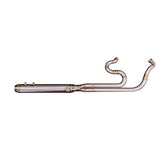

# Bagger Full Length Exhaust - Harley Bagger M8 17-23

[All parts](../README.md) · [System](../systems/exhaust.md)

| Field | Record |
| --- | --- |
| Status | Delivered |
| Quantity | 1  |
| Part number | HPI-EXM8B-S |
| Part-number evidence | Manufacturer catalog match; verify received part label |
| Order / source | Hoban Brothers 1213 |
| Order date | 2026-10-17 |
| Documentation checked | 2026-10-23 |

## Product and installation documents

- [Product reference](https://hobanbrothers.com/products/hpi-twin-cam-bagger-full-length-exhaust?variant=45100446875876)
- [Manufacturer product](https://www.horsepowerinc.net/product-page/milwaukee-8-bagger-2017)
- [HPi M8 Bagger Full Length Exhaust Install — section 07](https://www.horsepowerinc.net/tech) — official installation video on tech page

**Documentation note:** Official installation video found; no downloadable paper exhaust manual located.

## Build notes

- Delivered Oct22.
- Select Full Length M8 and 2017–2023 M8 Standard on factory listing. The Hoban URL contains twin-cam text, but ordered variant and seller SKU identify M8.
- HPi says new systems include required brackets, clamps and installation hardware. Do not add duplicate hardware orders.
- Exact hardware quantities are not published on reviewed pages. Inventory shipped package against included instructions.

## Kit / assembly itemization

Components are grouped with this product. Separately indexed equipment and assembly references are not additional purchases. Read each row’s inclusion note.

| Included component | Quantity | Part number | Reference | Inclusion / identification note |
| --- | --- | --- | --- | --- |
| Stainless header/collector and full-length muffler assembly | 1 | Not published | [Parent product / kit reference](https://www.horsepowerinc.net/product-page/milwaukee-8-bagger-2017) |  |
| Exhaust mounting brackets | included; count not published | Not published | [Kit/manual parts reference](https://www.horsepowerinc.net/product-page/fxr-baker-transmission-bracket) |  |
| Exhaust clamps | included; count not published | Not published | [Kit/manual parts reference](https://www.horsepowerinc.net/product-page/exhaust-clamps) |  |
| Exhaust hardware | included; count not published | Not published | [Kit/manual parts reference](https://www.horsepowerinc.net/product-page/exhaust-hardware) |  |

**Kit documentation gap:** Some internal parts have only an illustrated kit/manual reference; separate retail listings or service SKUs were not verified. Do not treat a parent-kit link as a standalone component offer.

## Evidence

- Gmail message 1a14849a90a5b4da; order reference Hoban Brothers 1213
- Gmail message 1a165d7306df68bf; order reference Hoban Brothers 1213
- Public source: https://www.horsepowerinc.net/exhausts
- Public source: https://www.horsepowerinc.net/tech
- Public source: https://hobanbrothers.com/products/hpi-twin-cam-bagger-full-length-exhaust?variant=45100446875876
- Public source: https://www.cyclesolutions.com/product/horsepower-inc-hpi-exm8b-s-stainless-steel-full-length-exhaust-for-m8-touring/
- Prior project inventory: Street_Glide_Master_Parts.xlsx, October 20, 2026, worksheet row 18.

## Builder record

- [ ] Received and box label matched
- [ ] Hardware and instructions present
- [ ] Installed / retained / superseded decision recorded
- [ ] Function checked

Installed date: __________  Technician: __________

Notes: ____________________________________________________
