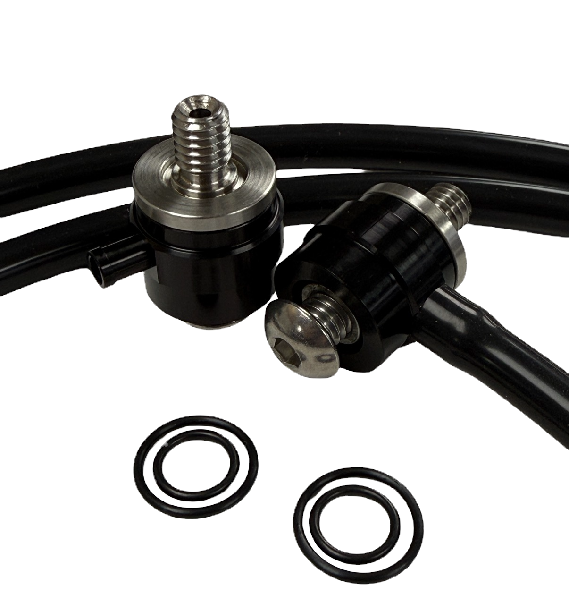

# HPi External Breather System — M8 0.940, 2017–2023

[Home](../README.md) · [All parts A–Z](../PARTS_INDEX.md) · [System](../systems/engine.md)

*Photo: Manufacturer system-family product photo. Page offers multiple lengths and does not assign a different image specifically to the 0.940 variant.*

| Field | Record |
| --- | --- |
| Status | Ordered |
| Quantity | 1  |
| Part number | HPI-EBS-M8 |
| Part-number evidence | Manufacturer catalog match; verify received part label |
| Order / source | October 20 owner inventory / purchase image confirmation |
| Documentation checked | 2026-10-23 |

## Product and installation documents

- [Product reference](https://www.horsepowerinc.net/product-page/billet-pro-external-breather-kit)
- [HPi external breather written installation instructions](https://www.horsepowerinc.net/product-page/billet-pro-external-breather-kit) — manufacturer HTML instructions within product description
- [External Breather System Install — HPi Tech section 03](https://www.horsepowerinc.net/tech) — official installation video

**Documentation note:** Official written HTML instructions and official installation video located. No separate PDF found.

## Build notes

- Gen I 2017–2023 M8 selection confirmed.
- Designed around HPi V2/Billet-Pro air-cleaner mounting; manufacturer also permits selected flat-backplate air cleaners. Exact integration with separately ordered Feuling BA air cleaner requires builder/HPi confirmation.
- Use the manufacturer instructions for fastener preparation and assembly sequence.

## Kit / assembly itemization

Components are grouped with this product. Separately indexed equipment and assembly references are not additional purchases. Read each row’s inclusion note.

| Included component | Quantity | Part number | Reference | Inclusion / identification note |
| --- | --- | --- | --- | --- |
| Stainless head-threaded insert assemblies | 2 | Not published | [Parent product / kit reference](https://www.horsepowerinc.net/product-page/billet-pro-external-breather-kit) | Two assemblies appear in manufacturer product photo; exact insert sub-part numbers not published. |
| Black external breather spacers with hose nipples | 2 | Not published | [Parent product / kit reference](https://www.horsepowerinc.net/product-page/billet-pro-external-breather-kit) | Photo-observed pair; ordered system uses 0.940 M8 selection. |
| Air-cleaner mounting bolts | 2 | Not published | [Parent product / kit reference](https://www.horsepowerinc.net/product-page/billet-pro-external-breather-kit) | One per insert assembly in photo; no individual thread/length specifications published. |
| 3 mm / 1/8 inch ID silicone vacuum hose | included; length not published | Not published | [Parent product / kit reference](https://www.horsepowerinc.net/product-page/billet-pro-external-breather-kit) | Hose specification stated by manufacturer. |
| Sealing O-rings | included; exact count not published | Not published | [Parent product / kit reference](https://www.horsepowerinc.net/product-page/billet-pro-external-breather-kit) | Fully O-ringed system per manufacturer; no exploded seal BOM located. |

Manufacturer description and system photograph; no individual component retail listings or complete exploded parts list located.

**Kit documentation gap:** Some internal parts have only an illustrated kit/manual reference; separate retail listings or service SKUs were not verified. Do not treat a parent-kit link as a standalone component offer.

## Evidence

- October 20 owner inventory and purchase-image confirmation; ordered, installation unconfirmed.
- Public source: https://www.horsepowerinc.net/product-page/billet-pro-external-breather-kit
- Public source: https://www.horsepowerinc.net/tech
- Public source: https://www.horsepowerinc.net/performanceparts
- Prior project inventory: Street_Glide_Master_Parts.xlsx, October 20, 2026, worksheet row 15.

## Builder record

- [ ] Received and box label matched
- [ ] Hardware and instructions present
- [ ] Installed / retained / superseded decision recorded
- [ ] Function checked

Installed date: __________  Technician: __________

Notes: ____________________________________________________
