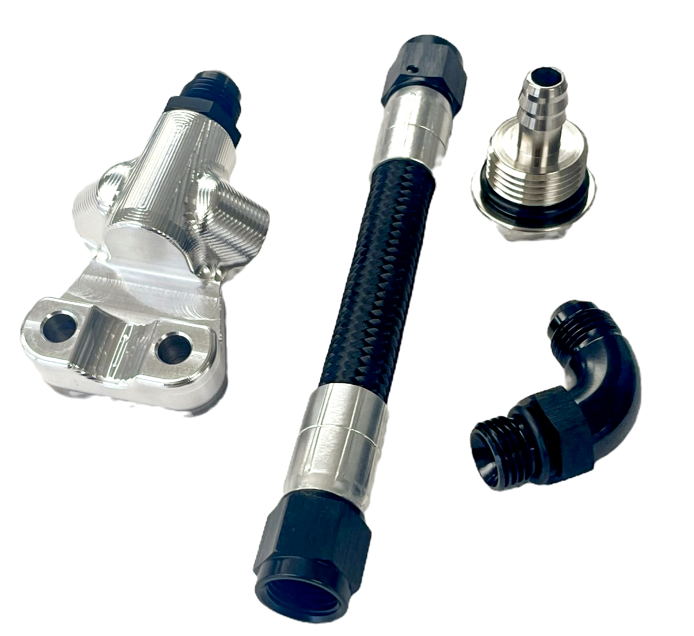

# HPi M8 Bagger High Flow Fuel Rail Kit

[All parts](../README.md) · [System](../systems/engine.md)

*Photo: Manufacturer exact M8 High Flow Fuel Rail kit photo; page data links it specifically to M8 Bagger High Flow Fuel Rail Kit.*

| Field | Record |
| --- | --- |
| Status | Ordered |
| Quantity | 1  |
| Part number | HPI-M8HF-FR |
| Part-number evidence | Manufacturer catalog match; verify received part label |
| Order / source | October 20 owner inventory / purchase image confirmation |
| Documentation checked | 2026-10-23 |

## Product and installation documents

- [Product reference](https://www.horsepowerinc.net/product-page/high-flow-fuel-rail)
- [HPi official product specification and option selector](https://www.horsepowerinc.net/product-page/high-flow-fuel-rail) — product reference, not installation manual
- [HPi technical support and installation library](https://www.horsepowerinc.net/tech) — manufacturer support reference

**Documentation note:** No public downloadable installation manual or specific fuel-rail installation video found in the official technical library or targeted searches. Obtain packed instructions or HPi instructions before installation.

## Build notes

- Made for Gen I M8 Bagger application; official page excludes Gen II models.
- This is the complete HPI-M8HF-FR kit, distinct from HPI-M8S-FRR rail-only replacement.

## Kit / assembly itemization

Components are grouped with this product. Separately indexed equipment and assembly references are not additional purchases. Read each row’s inclusion note.

| Included component | Quantity | Part number | Reference | Inclusion / identification note |
| --- | --- | --- | --- | --- |
| M8 high-flow fuel rail | 1 | HPI-M8S-FRR | [Parent product / kit reference](https://www.horsepowerinc.net/product-page/high-flow-fuel-rail) | Rail-only replacement is selectable on the same official page as Replacement M8 Bagger Fuel Rail. |
| Braided fuel hose with end fittings | 1 | Not published | [Parent product / kit reference](https://www.horsepowerinc.net/product-page/high-flow-fuel-rail) | Visible in exact M8 kit photo; length and fitting thread specifications not published. |
| Fuel tank outlet adapter with sealing ring | 1 | Not published | [Parent product / kit reference](https://www.horsepowerinc.net/product-page/high-flow-fuel-rail) | Visible in exact M8 kit photo; manufacturer states kit eliminates factory tank quick-connect. |
| Elbow fitting | 1 | Not published | [Parent product / kit reference](https://www.horsepowerinc.net/product-page/high-flow-fuel-rail) | Visible in exact M8 kit photo; exact AN/thread specification not published. |

Photo-observed assemblies, not a factory exploded BOM; confirm all small fittings and seals against packed instructions.

**Kit documentation gap:** Some internal parts have only an illustrated kit/manual reference; separate retail listings or service SKUs were not verified. Do not treat a parent-kit link as a standalone component offer.

## Evidence

- October 20 owner inventory and purchase-image confirmation; ordered, installation unconfirmed.
- Public source: https://www.horsepowerinc.net/product-page/high-flow-fuel-rail
- Public source: https://www.horsepowerinc.net/tech
- Prior project inventory: Street_Glide_Master_Parts.xlsx, October 20, 2026, worksheet row 14.

## Builder record

- [ ] Received and box label matched
- [ ] Hardware and instructions present
- [ ] Installed / retained / superseded decision recorded
- [ ] Function checked

Installed date: __________  Technician: __________

Notes: ____________________________________________________
