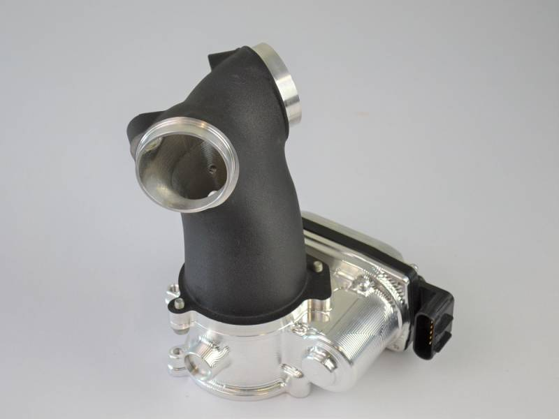

# 62mm Throttle Body Milwaukee-8

[All parts](../README.md) · [System](../systems/engine.md)

*Photo: Product/catalog image; inspect supplied hardware and finish against order description.*

| Field | Record |
| --- | --- |
| Status | Shipped |
| Quantity | 1  |
| Part number | HPI-62M8-19 |
| Part-number evidence | Order-confirmed SKU |
| Order / source | Fuel Moto 2431652 |
| Order date | 2026-10-17 |
| Variant | Order complete Oct20. Includes $249 TB core charge, send TB later. |
| Documentation checked | 2026-10-23 |

## Product and installation documents

- [Ordered product listing](https://www.fuelmotousa.com/i-23898815-hpi-62mm-throttle-body-milwaukee-8-harley-davidson.html)
- [Manufacturer product](https://www.horsepowerinc.net/)
- [HPI/Fuel Moto supplied installation support](https://www.fuelmotousa.com/i-23898815-hpi-62mm-throttle-body-milwaukee-8-harley-davidson.html) — No matching standalone installation PDF located; supplied instructions and OEM induction procedure still required

## Build notes

- Order complete Oct20. Includes $249 TB core charge, send TB later.
- Exact HPI-62M8-19 SKU is printed in the order.
- Order selected the $249 return-core-later arrangement. Preserve the removed throttle body/core and reconcile return instructions with Fuel Moto.
- 6.3 g/sec injectors were a separately selected line item and are listed separately below.
- Feuling 5434 manufacturer page lists standard-pattern HPI 58mm/62mm compatibility; nevertheless confirm actual bracket, seals, breather routing and clearance during assembly.

## Kit / assembly itemization

Components are grouped with this product. Separately indexed equipment and assembly references are not additional purchases. Read each row’s inclusion note.

| Included component | Quantity | Part number | Reference | Inclusion / identification note |
| --- | --- | --- | --- | --- |
| 62mm billet throttle body | 1 | Not published | [Parent product / kit reference](https://www.fuelmotousa.com/i-23898815-hpi-62mm-throttle-body-milwaukee-8-harley-davidson.html) | Supplied assembly; separate throttle-body-only SKU not verified. |
| CNC-ported intake manifold | 1 | Not published | [Parent product / kit reference](https://www.fuelmotousa.com/i-23898815-hpi-62mm-throttle-body-milwaukee-8-harley-davidson.html) | Part of ordered assembly; separate matching manifold SKU not verified. |
| New installation seals | one set | Not published | [Parent product / kit reference](https://www.fuelmotousa.com/i-23898815-hpi-62mm-throttle-body-milwaukee-8-harley-davidson.html) | Included according to product page; individual seal SKUs not established. |
| Factory electronic throttle assembly/core exchange | 1 | Not published | [Parent product / kit reference](https://www.fuelmotousa.com/i-23898815-hpi-62mm-throttle-body-milwaukee-8-harley-davidson.html) | Uses factory electronic assembly; this is an exchange/core requirement, not evidence that new replacement electronics were separately purchased. |

**Kit documentation gap:** Some internal parts have only an illustrated kit/manual reference; separate retail listings or service SKUs were not verified. Do not treat a parent-kit link as a standalone component offer.

## Evidence

- Gmail message 1a148638a2cede92; order reference Fuel Moto 2431652
- Gmail message 1a15b3ddc32ce313; order reference Fuel Moto 2431652
- Public source: https://www.fuelmotousa.com/i-23898815-hpi-62mm-throttle-body-milwaukee-8-harley-davidson.html
- Public source: https://www.horsepowerinc.net/
- Prior project inventory: Street_Glide_Master_Parts.xlsx, October 20, 2026, worksheet row 12.

## Builder record

- [ ] Received and box label matched
- [ ] Hardware and instructions present
- [ ] Installed / retained / superseded decision recorded
- [ ] Function checked

Installed date: __________  Technician: __________

Notes: ____________________________________________________
