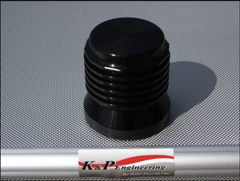

# Oil Filter (required for all M8 touring bikes)

[All parts](../README.md) · [System](../systems/cooling.md)

| Field | Record |
| --- | --- |
| Status | Shipped |
| Quantity | 1  |
| Part number | SQ3902660 |
| Part-number evidence | Order / packing-slip evidence |
| Order / source | OilBud 00375 |
| Order date | 2026-10-13 |
| Documentation checked | 2026-10-23 |

## Product and installation documents

- [Product reference](https://www.harleyoilcoolers.com/shop/p/kp-oil-filter)
- [K&P cleaning and assembly](https://kandpengineering.com/cleaning/) — Exact product family
- [OilBud installation guide including filter](https://www.harleyoilcoolers.com/s/Harley-Davidson-Touring-Bagger-M8-Oil-Cooled-2017-2021-Installation-Guide.pdf) — Exact product family
- [Downloaded PDF copy: OilBud installation guide including filter](../manuals/oilbud-03b1d6aa.pdf)

## Build notes

- Black; shipped Oct22.
- Manufacturer application chart lists S4 for Milwaukee-Eight, but OilBud order identifies merchant SKU only. Confirm S4 label before ordering internal service parts.
- S4 reference product: https://kandpengineering.com/product/s4/ . Manufacturer S4 service parts are C2 housing, QR2 quad ring, FE4 filter element, FERS1 retaining spring, CW1 cup wrench; listed as candidate service mapping only.

## Evidence

- Gmail message 1a137de11bd3fc23; order reference OilBud 00375

## Builder record

- [ ] Received and box label matched
- [ ] Hardware and instructions present
- [ ] Installed / retained / superseded decision recorded
- [ ] Function checked

Installed date: __________  Technician: __________

Notes: ____________________________________________________
