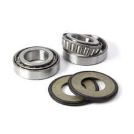

# Steering Bearing Kit

[Home](../README.md) · [All parts A–Z](../PARTS_INDEX.md) · [System](../systems/front-end.md)

| Field | Record |
| --- | --- |
| Status | Quoted — payment unverified |
| Quantity | 1  |
| Part number | 22-1068 |
| Part-number evidence | Order / packing-slip evidence |
| Order / source | Quote QN-47918 |
| Order date | 2026-10-20 |
| Documentation checked | 2026-10-23 |

## Product and installation documents

- [Product reference](https://www.allballsracing.com/22-1068.html)
- [KR8 steering stem / neck bearing installation context](https://krausmotorco.com/kr8-inverted-front-end-installation-guide/) — Applicable assembly guide; no standalone All Balls instruction PDF verified.

## Build notes

- 30mm; 2014-up Touring.
- All Balls lists FLHX Street Glide 2014–2026 in fitment, including 2018.
- Individual bearing/seal part numbers and separately orderable links are not disclosed in product-page kit contents.

## Kit / assembly itemization

Components are grouped with this product. Separately indexed equipment and assembly references are not additional purchases. Read each row’s inclusion note.

| Included component | Quantity | Part number | Reference | Inclusion / identification note |
| --- | --- | --- | --- | --- |
| Tapered steering bearing | 2 | Not published | [Parent product / kit reference](https://www.allballsracing.com/22-1068.html) | No separately orderable item page verified; link is the containing kit or assembly reference. |
| Seal | 2 | Not published | [Parent product / kit reference](https://www.allballsracing.com/22-1068.html) | No separately orderable item page verified; link is the containing kit or assembly reference. |

**Kit documentation gap:** Some internal parts have only an illustrated kit/manual reference; separate retail listings or service SKUs were not verified. Do not treat a parent-kit link as a standalone component offer.

## Evidence

- Gmail message 1a15aa1ef75f0668; order reference Quote QN-47918
- Public source: https://www.allballsracing.com/22-1068.html

## Builder record

- [ ] Received and box label matched
- [ ] Hardware and instructions present
- [ ] Installed / retained / superseded decision recorded
- [ ] Function checked

Installed date: __________  Technician: __________

Notes: ____________________________________________________
