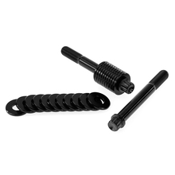

# Radial Caliper Titanium Hardware Kit - Universal

[Home](../README.md) · [All parts A–Z](../PARTS_INDEX.md) · [System](../systems/brakes.md)

| Field | Record |
| --- | --- |
| Status | Quoted — payment unverified |
| Quantity | 2  |
| Part number | UN-BR-T80-BB |
| Part-number evidence | Order / packing-slip evidence |
| Order / source | Quote QN-47918 |
| Order date | 2026-10-20 |
| Variant | 80mm; black bolts / black spacers |
| Documentation checked | 2026-10-23 |

## Product and installation documents

- [Product reference](https://krausmotorco.com/radial-caliper-titanium-hardware-kit-universal/)
- [Brembo M4 rotor spacer and bolt recommendations](https://krausmotorco.com/content/pdfs/BremboM4_Spacer_Bolt_Recommendations_.pdf) — Read
- [Radial caliper mounting hardware sizing chart](https://krausmotorco.com/content/pdfs/radial-caliper-mounting-hardware-sizing-chart-V2.pdf) — Verified PDF
- [Downloaded PDF copy: Brembo M4 rotor spacer and bolt recommendations](../manuals/kraus-caliper-bolts-962f4c37.pdf)
- [Downloaded PDF copy: Radial caliper mounting hardware sizing chart](../manuals/kraus-caliper-bolts-a68c7c38.pdf)

## Build notes

- 80mm kit; black anodized bolts and spacers.
- One kit mounts one caliper; quote quantity 2 covers dual calipers.
- For Brembo M4 with KR8 and 330mm rotor, the Kraus-specific chart calls for 80mm bolts and 7 spacers at the illustrated spacing point. Builder should follow chart geometry, actual rotor centering, and current torque sheet.

## Kit / assembly itemization

Components are grouped with this product. Separately indexed equipment and assembly references are not additional purchases. Read each row’s inclusion note.

| Included component | Quantity | Part number | Reference | Inclusion / identification note |
| --- | --- | --- | --- | --- |
| M10 x 1.25 x 80mm titanium 12-point bolt | 2 | Not published | [Parent product / kit reference](https://krausmotorco.com/radial-caliper-titanium-hardware-kit-universal/) | Quantity per kit; 4 total for quote quantity 2. |
| 2.5mm stackable black caliper spacers | 22 | UN-BRS-002-B (individual spacer listing) | [Kit/manual parts reference](https://krausmotorco.com/radial-caliper-spacers-2-5mm/) | Quantity per 80mm kit; 44 total supplied across quote quantity 2. Install only required spacers. |

**Kit documentation gap:** Some internal parts have only an illustrated kit/manual reference; separate retail listings or service SKUs were not verified. Do not treat a parent-kit link as a standalone component offer.

## Evidence

- Gmail message 1a15aa1ef75f0668; order reference Quote QN-47918
- Public source: https://krausmotorco.com/radial-caliper-titanium-hardware-kit-universal/
- Public source: https://krausmotorco.com/content/pdfs/BremboM4_Spacer_Bolt_Recommendations_.pdf
- Public source: https://krausmotorco.com/radial-caliper-spacers-2-5mm/

## Builder record

- [ ] Received and box label matched
- [ ] Hardware and instructions present
- [ ] Installed / retained / superseded decision recorded
- [ ] Function checked

Installed date: __________  Technician: __________

Notes: ____________________________________________________
