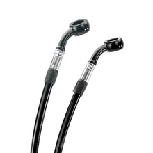

# Dual Front Caliper Brake Line (Bagger)

[All parts](../README.md) · [System](../systems/brakes.md)

| Field | Record |
| --- | --- |
| Status | Quoted — payment unverified |
| Quantity | 1  |
| Part number | EL-2000 |
| Part-number evidence | Order / packing-slip evidence |
| Order / source | Quote QN-47918 |
| Order date | 2026-10-20 |
| Documentation checked | 2026-10-23 |

## Product and installation documents

- [Product reference](https://krausmotorco.com/brake-line-kit-bagger/)
- [Brake line routing diagram](https://krausmotorco.com/content/pdfs/Brake-Line-Diagram.pdf) — Read
- [Downloaded PDF copy: Brake line routing diagram](../manuals/kraus-line-66bf7810.pdf)

## Build notes

- 2018 Street Glide.
- Designed with Spiegler for KR8 and Kraus axial-to-radial front mounts.
- Routing diagram places shorter front line on motorcycle's left.
- This is the two lower front-caliper lines, not proof that upper master-cylinder hose length covers the new bars.

## Kit / assembly itemization

Components are grouped with this product. Separately indexed equipment and assembly references are not additional purchases. Read each row’s inclusion note.

| Included component | Quantity | Part number | Reference | Inclusion / identification note |
| --- | --- | --- | --- | --- |
| Front brake line | 2 | Not published | [Parent product / kit reference](https://krausmotorco.com/brake-line-kit-bagger/) | No separately orderable item page verified; link is the containing kit or assembly reference. |
| Crush washers | set; exact quantity not stated | Not published | [Parent product / kit reference](https://krausmotorco.com/brake-line-kit-bagger/) | No separately orderable item page verified; link is the containing kit or assembly reference. |
| Banjo-rotation clamping blocks | set; exact quantity not stated | Not published | [Parent product / kit reference](https://krausmotorco.com/brake-line-kit-bagger/) | No separately orderable item page verified; link is the containing kit or assembly reference. |

**Kit documentation gap:** Some internal parts have only an illustrated kit/manual reference; separate retail listings or service SKUs were not verified. Do not treat a parent-kit link as a standalone component offer.

## Evidence

- Gmail message 1a15aa1ef75f0668; order reference Quote QN-47918
- Public source: https://krausmotorco.com/brake-line-kit-bagger/
- Public source: https://krausmotorco.com/content/pdfs/Brake-Line-Diagram.pdf

## Builder record

- [ ] Received and box label matched
- [ ] Hardware and instructions present
- [ ] Installed / retained / superseded decision recorded
- [ ] Function checked

Installed date: __________  Technician: __________

Notes: ____________________________________________________
