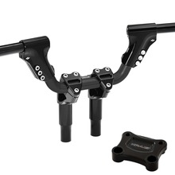

# Open Road Kit (Pre-24 Street Glide, Ultra, Electra)

[All parts](../README.md) · [System](../systems/controls.md)

| Field | Record |
| --- | --- |
| Status | Quoted — payment unverified |
| Quantity | 1  |
| Part number | KT-ST-SG-232-B |
| Part-number evidence | Order / packing-slip evidence |
| Order / source | Quote QN-47918 |
| Order date | 2026-10-20 |
| Variant | 13.5 in total height; black |
| Documentation checked | 2026-10-23 |

## Product and installation documents

- [Product reference](https://krausmotorco.com/open-road-kit-pre-24-street-glide-ultra-electra/)
- [Adjustable ISO Bar installation](https://krausmotorco.com/content/pdfs/Kraus%20ISO%20Bar%20Instructions.pdf) — Manufacturer product-page link; web text fetch timed out.
- [Workman riser installation](https://krausmotorco.com/content/pdfs/kraus-workman-riser-install.pdf) — Verified PDF.
- [T-Rex assembly schematic](https://krausmotorco.com/content/pdfs/ST-PB-01%20Schematic.pdf) — Read
- [Batwing nacelle cut template](https://krausmotorco.com/content/pdfs/Batwing-nacelle-cut-template.pdf) — Manufacturer product-page link; web text fetch timed out.
- [Downloaded PDF copy: Adjustable ISO Bar installation](../manuals/kraus-open-16ba7a8d.pdf)
- [Downloaded PDF copy: Workman riser installation](../manuals/kraus-open-e1adf933.pdf)
- [Downloaded PDF copy: T-Rex assembly schematic](../manuals/kraus-open-f8745341.pdf)
- [Downloaded PDF copy: Batwing nacelle cut template](../manuals/kraus-open-443e00a7.pdf)

## Build notes

- 13.5" height; black anodized; 2018 Street Glide.
- Fits manufacturer-listed 2008–2023 Street Glide/Ultra/Electra.
- Manufacturer notes stock key switch / steering lock cannot be used in stock position with T-Rex plate; document planned relocation or supported configuration before assembly.
- Electrical/control and hydraulic line extensions are not claimed included.

## Kit / assembly itemization

Components are grouped with this product. Separately indexed equipment and assembly references are not additional purchases. Read each row’s inclusion note.

| Included component | Quantity | Part number | Reference | Inclusion / identification note |
| --- | --- | --- | --- | --- |
| Adjustable ISO Bar | 1 | UN-HB-33-B (manufacturer product-page black default; exact box label to match) | [Kit/manual parts reference](https://krausmotorco.com/adjustable-iso-bar/) | Included; do not count as another purchase. |
| Workman Kickback Riser assembly | 1 | Not published | [Kit/manual parts reference](https://krausmotorco.com/kraus-workman-risers/) | Included. Exact standalone riser-height SKU not established from kit page. |
| Touring T-Rex Pull Back Plate | 1 | ST-PB-01-B | [Kit/manual parts reference](https://krausmotorco.com/t-rex-pull-back-plate/) | Included; plate product page and schematic identify ST-PB-01 family. |

**Kit documentation gap:** Some internal parts have only an illustrated kit/manual reference; separate retail listings or service SKUs were not verified. Do not treat a parent-kit link as a standalone component offer.

## Evidence

- Gmail message 1a15aa1ef75f0668; order reference Quote QN-47918
- Public source: https://krausmotorco.com/open-road-kit-pre-24-street-glide-ultra-electra/
- Public source: https://krausmotorco.com/adjustable-iso-bar/
- Public source: https://krausmotorco.com/kraus-workman-risers/
- Public source: https://krausmotorco.com/t-rex-pull-back-plate/

## Builder record

- [ ] Received and box label matched
- [ ] Hardware and instructions present
- [ ] Installed / retained / superseded decision recorded
- [ ] Function checked

Installed date: __________  Technician: __________

Notes: ____________________________________________________
