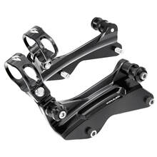

# Pro-4 Docking Hardware

[Home](../README.md) · [All parts A–Z](../PARTS_INDEX.md) · [System](../systems/front-end.md)

*Photo: Representative manufacturer family photo; default web page displays ST-SC-40-B, while the quoted configuration is ST-SC-41-B with Öhlins clamps.*

| Field | Record |
| --- | --- |
| Status | Quoted — payment unverified |
| Quantity | 1  |
| Part number | ST-SC-41-B |
| Part-number evidence | Order / packing-slip evidence |
| Order / source | Quote QN-47918 |
| Order date | 2026-10-20 |
| Variant | Black with Öhlins reservoir clamp configuration |
| Documentation checked | 2026-10-23 |

## Product and installation documents

- [Product reference](https://krausmotorco.com/pro-4-docking-hardware/)
- [Pro-4 installation and illustrated parts list](https://krausmotorco.com/content/pdfs/kraus-pro-4-docking-hardware-install.pdf) — Read; downloaded PDF and extracted complete parts table.
- [Downloaded PDF copy: Pro-4 installation and illustrated parts list](../manuals/kraus-pro4-e0f65883.pdf)

## Build notes

- Black anodized; Ohlins clamping size; 2018 Street Glide. Vendor Oct21 says processing follows receipt of wire; no payment receipt read.
- Current manufacturer compatibility list: Öhlins HD044, HD779, HD050 and HD051. User history identifies HD778; exact reservoir model/diameter and hose clearance remain a builder confirmation, not proof of incompatibility.
- Install reservoir clamps on plates before mounting plates to motorcycle.

## Kit / assembly itemization

Components are grouped with this product. Separately indexed equipment and assembly references are not additional purchases. Read each row’s inclusion note.

| Included component | Quantity | Part number | Reference | Inclusion / identification note |
| --- | --- | --- | --- | --- |
| Left docking plate | 1 | Not published | [Kit/manual parts reference](https://krausmotorco.com/content/pdfs/kraus-pro-4-docking-hardware-install.pdf) | No separately orderable item page verified; link is the containing kit or assembly reference. |
| Right docking plate | 1 | Not published | [Kit/manual parts reference](https://krausmotorco.com/content/pdfs/kraus-pro-4-docking-hardware-install.pdf) | No separately orderable item page verified; link is the containing kit or assembly reference. |
| Outer docking spacer | 4 | Not published | [Kit/manual parts reference](https://krausmotorco.com/content/pdfs/kraus-pro-4-docking-hardware-install.pdf) | No separately orderable item page verified; link is the containing kit or assembly reference. |
| Docking bushing | 4 | Not published | [Kit/manual parts reference](https://krausmotorco.com/content/pdfs/kraus-pro-4-docking-hardware-install.pdf) | No separately orderable item page verified; link is the containing kit or assembly reference. |
| Inner forward docking spacer | 2 | Not published | [Kit/manual parts reference](https://krausmotorco.com/content/pdfs/kraus-pro-4-docking-hardware-install.pdf) | No separately orderable item page verified; link is the containing kit or assembly reference. |
| Inner rear docking spacer | 2 | Not published | [Kit/manual parts reference](https://krausmotorco.com/content/pdfs/kraus-pro-4-docking-hardware-install.pdf) | No separately orderable item page verified; link is the containing kit or assembly reference. |
| 5/16-18 x 1 in stainless socket screw | 4 | Not published | [Kit/manual parts reference](https://krausmotorco.com/content/pdfs/kraus-pro-4-docking-hardware-install.pdf) | No separately orderable item page verified; link is the containing kit or assembly reference. |
| 5/16-18 x 1-1/4 in socket head screw | 2 | Not published | [Kit/manual parts reference](https://krausmotorco.com/content/pdfs/kraus-pro-4-docking-hardware-install.pdf) | No separately orderable item page verified; link is the containing kit or assembly reference. |
| Öhlins reservoir clamp | 2 | Not published | [Parent product / kit reference](https://krausmotorco.com/pro-4-docking-hardware/) | Included by quoted clamp configuration. Current general manual labels reservoir clamps as separately purchased for base kit. |
| 5/16-18 stainless nylon-insert jam locknut | 2 | Not published | [Kit/manual parts reference](https://krausmotorco.com/content/pdfs/kraus-pro-4-docking-hardware-install.pdf) | No separately orderable item page verified; link is the containing kit or assembly reference. |
| 5/16-18 x .75 in stainless 12-point screw | 2 | Not published | [Kit/manual parts reference](https://krausmotorco.com/content/pdfs/kraus-pro-4-docking-hardware-install.pdf) | No separately orderable item page verified; link is the containing kit or assembly reference. |
| 1/4 in OD x 1/4 in stainless dowel pin | 2 | Not published | [Kit/manual parts reference](https://krausmotorco.com/content/pdfs/kraus-pro-4-docking-hardware-install.pdf) | No separately orderable item page verified; link is the containing kit or assembly reference. |
| 5/16-18 x 5/8 in socket screw | 2 | Not published | [Kit/manual parts reference](https://krausmotorco.com/content/pdfs/kraus-pro-4-docking-hardware-install.pdf) | No separately orderable item page verified; link is the containing kit or assembly reference. |
| 5/16-18 x 1-3/4 in stainless socket screw | 2 or 4 depending on kit | Not published | [Kit/manual parts reference](https://krausmotorco.com/content/pdfs/kraus-pro-4-docking-hardware-install.pdf) | No separately orderable item page verified; link is the containing kit or assembly reference. |

**Kit documentation gap:** Some internal parts have only an illustrated kit/manual reference; separate retail listings or service SKUs were not verified. Do not treat a parent-kit link as a standalone component offer.

## Evidence

- Gmail message 1a15aa1ef75f0668; order reference Quote QN-47918
- Public source: https://krausmotorco.com/pro-4-docking-hardware/
- Public source: https://krausmotorco.com/content/pdfs/kraus-pro-4-docking-hardware-install.pdf

## Builder record

- [ ] Received and box label matched
- [ ] Hardware and instructions present
- [ ] Installed / retained / superseded decision recorded
- [ ] Function checked

Installed date: __________  Technician: __________

Notes: ____________________________________________________
