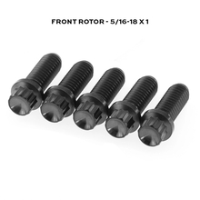

# Titanium Brake Rotor Hardware Kit

[All parts](../README.md) · [System](../systems/brakes.md)

| Field | Record |
| --- | --- |
| Status | Quoted — payment unverified |
| Quantity | 1  |
| Part number | HD-T516-B5 |
| Part-number evidence | Order / packing-slip evidence |
| Order / source | Quote QN-47918 |
| Order date | 2026-10-20 |
| Variant | Black; 5/16-18 x 1 in; hub mount |
| Documentation checked | 2026-10-23 |

## Product and installation documents

- [Product reference](https://krausmotorco.com/titanium-brake-rotor-hardware-kit/)
- [Manufacturer installation torque / fitment notes on product page](https://krausmotorco.com/titanium-brake-rotor-hardware-kit/) — Read; no standalone PDF listed.

## Build notes

- Front rotor; 5/16-18 x 1; black anodized.
- Manufacturer calls for two packs for dual discs; quote shows one. Reconcile supplied OG-kit fasteners or add second pack if matching titanium bolts are wanted for both rotors.
- Hub-mount only; not compatible with spoke-mount rotor pattern. Final wheel choice must match hardware.

## Kit / assembly itemization

Components are grouped with this product. Separately indexed equipment and assembly references are not additional purchases. Read each row’s inclusion note.

| Included component | Quantity | Part number | Reference | Inclusion / identification note |
| --- | --- | --- | --- | --- |
| 5/16-18 x 1 in G5 titanium 12-point rotor bolt | 5 | Not published | [Parent product / kit reference](https://krausmotorco.com/titanium-brake-rotor-hardware-kit/) | Five bolts per pack; individual bolt sale not verified. |

**Kit documentation gap:** Some internal parts have only an illustrated kit/manual reference; separate retail listings or service SKUs were not verified. Do not treat a parent-kit link as a standalone component offer.

## Evidence

- Gmail message 1a15aa1ef75f0668; order reference Quote QN-47918
- Public source: https://krausmotorco.com/titanium-brake-rotor-hardware-kit/

## Builder record

- [ ] Received and box label matched
- [ ] Hardware and instructions present
- [ ] Installed / retained / superseded decision recorded
- [ ] Function checked

Installed date: __________  Technician: __________

Notes: ____________________________________________________
