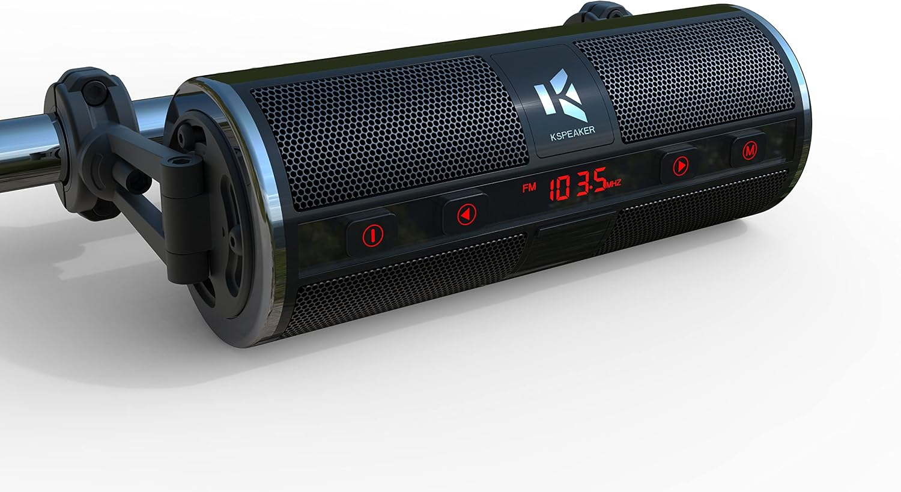

# KSPEAKER Motorcycle Speakers Bluetooth Waterproof Radio Audio System Built-in Amplifier, 3 Inch Metal Mp3 Player, Great for ATV, Scooter Bike,12 Volt Vehicle, K2BL

[All parts](../README.md) · [System](../systems/historical-candidates.md)

*Photo: Amazon exact K2BL black listing; matches order product name, historical order did not expose ASIN*

| Field | Record |
| --- | --- |
| Status | Historical — bike allocation unconfirmed |
| Quantity | 1  |
| Part number | Not confirmed |
| Order / source | Amazon; Shop history |
| Order date | 2023-05-10 |
| Documentation checked | 2026-10-23 |

## Product and installation documents

- [Product reference](https://www.kspeaker.com/products/kspeaker-motorcycle-speakers-k2bl)
- [Retailer exact-model reference](https://www.amazon.com/dp/B0BYVDLKYJ)
- [K-SPEAKER Audio System K2 User Manual](https://cdn.shopify.com/s/files/1/0517/4827/4331/files/K2_English_instruction_manual.pdf?v=1681375449) — Manufacturer PDF for K2 family (K2BL black variant); Official manual page links PDF; downloaded and cover visually verified
- [KSPEAKER official user manuals index](https://www.kspeaker.com/pages/user-manuals) — Manufacturer support index
- [Downloaded PDF copy: K-SPEAKER Audio System K2 User Manual](../manuals/kspeaker-k2bl-f7bf1845.pdf)

## Build notes

- 2023 delivered purchase confirmed; current-bike assignment remains unconfirmed.
- Manufacturer product URL uses K2BL and current title K2. Manual names family K2; black versus chrome are finish variants.
- Avoid applying newly advertised current-product power/Bluetooth specifications to a 2023 unit without checking its label.

## Evidence

- Shop order 0196813d-b48a-750b-8cde-0537a0f55ba7; 2023-05-10

## Builder record

- [ ] Received and box label matched
- [ ] Hardware and instructions present
- [ ] Installed / retained / superseded decision recorded
- [ ] Function checked

Installed date: __________  Technician: __________

Notes: ____________________________________________________
