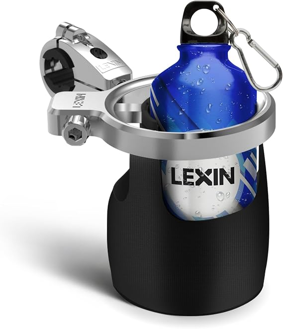

# LEXIN LX-C4 Motorcycle Cup Holder for Harley Davidson, Adjustable Drink Holder, Motorcycle Accessories, Fits Handlebar 7/8'' to 1 1/4'', Water Bottle Holder for ATV, Scooter, Boat, Kayak, Bike, Walker

[Home](../README.md) · [All parts A–Z](../PARTS_INDEX.md) · [System](../systems/historical-candidates.md)

*Photo: Seller exact LX-C4 black 2023 model listing*

| Field | Record |
| --- | --- |
| Status | Historical — bike allocation unconfirmed |
| Quantity | 1  |
| Part number | Not confirmed |
| Order / source | Amazon; Shop history |
| Order date | 2023-05-10 |
| Documentation checked | 2026-10-23 |

## Product and installation documents

- [Product reference](https://www.ubuy.ec/es/product/8K24X7S2G-lexin-lx-c4-motorcycle-cup-holder-adjustable-drink-holder-for-harley-davidson-bike-bicycle-stroller-scooter-wheel-wheelchair-canoe-atv-kayak)
- [Retailer exact-model reference](https://www.amazon.com/dp/B0BVFVC642)
- Exact manufacturer installation sheet not found; do not substitute C3 or newer LX-C04 chrome/32oz bundle manuals.

## Build notes

- 2023 delivered purchase confirmed; current-bike assignment remains unconfirmed.
- Seller listing identifies LX-C4, black, 7/8–1 1/4 inch handlebar fitment, first available February19 2023.
- Amazon ASIN derived from matching seller catalog; original Shop order did not expose ASIN.
- Seller listing currently unavailable; retained as exact-model reference.

## Kit / assembly itemization

Components are grouped with this product. Separately indexed equipment and assembly references are not additional purchases. Read each row’s inclusion note.

| Included component | Quantity | Part number | Reference | Inclusion / identification note |
| --- | --- | --- | --- | --- |
| Cup holder | 1 | Not published | [Parent package reference](https://www.amazon.com/dp/B0BVFVC642) |  |
| Handlebar clamp | 1 | Not published | [Parent package reference](https://www.amazon.com/dp/B0BVFVC642) |  |
| Thick spacer | 1 | Not published | [Parent package reference](https://www.amazon.com/dp/B0BVFVC642) |  |
| Thin spacer | 1 | Not published | [Parent package reference](https://www.amazon.com/dp/B0BVFVC642) |  |
| Screwdrivers | 2 | Not published | [Parent package reference](https://www.amazon.com/dp/B0BVFVC642) |  |
| Screws | 3 | Not published | [Parent package reference](https://www.amazon.com/dp/B0BVFVC642) |  |

**Kit documentation gap:** Seller listing for LX-C4 black / ASIN B0BVFVC642; individual replacement links not available

## Evidence

- Shop order 0196813d-b48a-750b-8cde-0537a0f55ba7; 2023-05-10

## Builder record

- [ ] Received and box label matched
- [ ] Hardware and instructions present
- [ ] Installed / retained / superseded decision recorded
- [ ] Function checked

Installed date: __________  Technician: __________

Notes: ____________________________________________________
