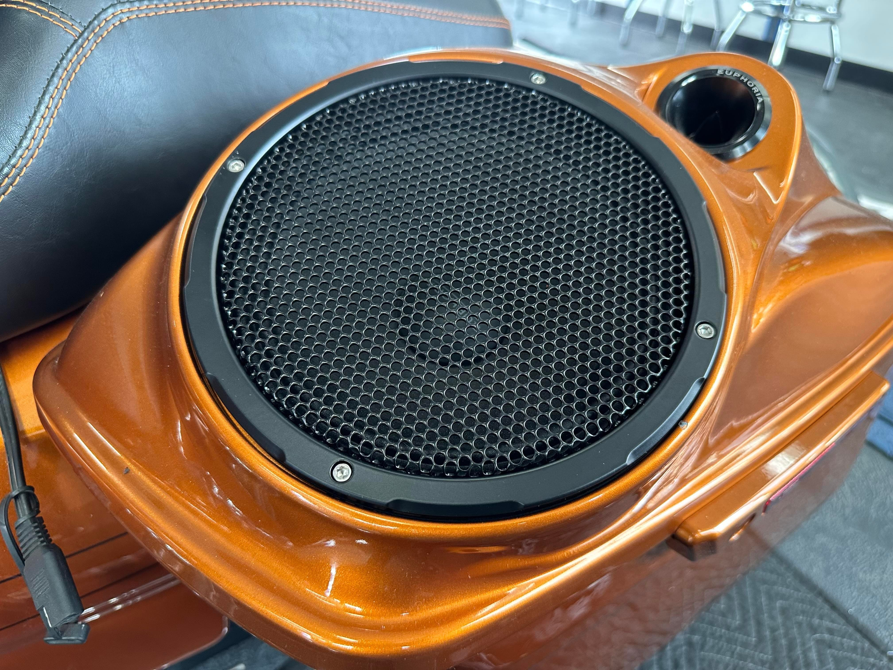

# Nagy's Customs 8" Speaker Grills (Pair) - Gloss Black — Gloss Black

[All parts](../README.md) · [System](../systems/audio.md)

| Field | Record |
| --- | --- |
| Status | Delivered |
| Quantity | 1  |
| Part number | Not confirmed |
| Order / source | Garage Bagger Stereo; Shop history |
| Order date | 2026-07-08 |
| Documentation checked | 2026-10-23 |

## Product and installation documents

- [Product reference](https://garagebaggerstereo.com/products/nagys-customs-speaker-grills-8?variant=44024500879586&_gsid=8LxibPGZHCFy&utm_source=shopify&utm_medium=catalog)
- An exact public installation manual was not located. Obtain the product-specific instructions from the manufacturer or use the applicable Harley service procedure for OEM replacement parts.

## Build notes

- Separate installation manual not located; obtain from Nagy's or Garage Bagger Stereo before drilling.
- Fastener counts are not published.

## Kit / assembly itemization

Components are grouped with this product. Separately indexed equipment and assembly references are not additional purchases. Read each row’s inclusion note.

| Included component | Quantity | Part number | Reference | Inclusion / identification note |
| --- | --- | --- | --- | --- |
| 8-inch gloss-black speaker grille | 2 | Not published | Separate component page not located; see parent kit/manual | Separate component page not located; see parent kit/manual |
| Stainless #8 Allen-head screws | Not published | Not published | Separate component page not located; see parent kit/manual | Separate component page not located; see parent kit/manual |
| Threaded inserts | Not published | Not published | Separate component page not located; see parent kit/manual | Separate component page not located; see parent kit/manual |
| Drill bit | 1 | Not published | Separate component page not located; see parent kit/manual | Separate component page not located; see parent kit/manual |
| Insert tool kit | 1 | Not published | Separate component page not located; see parent kit/manual | Separate component page not located; see parent kit/manual |

**Kit documentation gap:** Some internal parts have only an illustrated kit/manual reference; separate retail listings or service SKUs were not verified. Do not treat a parent-kit link as a standalone component offer.

## Evidence

- Shop order 019f3f63-f306-7e58-9d41-139e8decf5d9; 2026-07-08

## Builder record

- [ ] Received and box label matched
- [ ] Hardware and instructions present
- [ ] Installed / retained / superseded decision recorded
- [ ] Function checked

Installed date: __________  Technician: __________

Notes: ____________________________________________________
