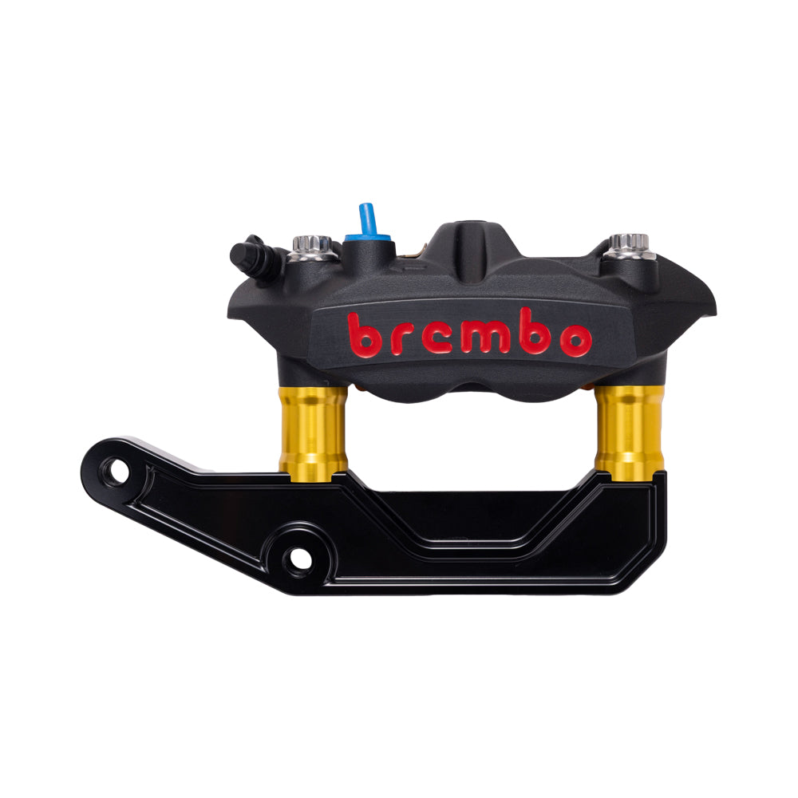

# 13" Complete Radial Big Brake Kit - Touring Dual Disc

[All parts](../README.md) · [System](../systems/brakes.md)

*Photo: Exact Black caliper / Gold spacers / Black bracket product color photograph, shared by Touring kit family.*

| Field | Record |
| --- | --- |
| Status | Ordered — corrected |
| Quantity | 1  |
| Part number | P-BR-13-BK-GD-BK |
| Part-number evidence | Catalog match to owner-confirmed Touring hub mount, dual disc, black calipers / gold spacers / black brackets |
| Order / source | Team Dream Rides 16720 |
| Order date | 2026-10-20 |
| Variant | Touring hub mount; dual disc; black calipers / gold spacers / black brackets |
| Documentation checked | 2026-10-23 |

## Product and installation documents

- [Product reference](https://originalgaragemoto.com/products/og-13-complete-radial-big-brake-kit-for-touring-hub-mount?variant=51698891063659)
- [Variant reference](https://originalgaragemoto.com/products/og-13-complete-radial-big-brake-kit-for-touring-hub-mount?variant=51698891063659)
- [Prior inventory reference (may illustrate product family)](https://originalgaragemoto.com/products/og-13-complete-radial-big-brake-kit-for-touring-hub-mount)
- [OG 13 inch Complete Radial Big Brake Kit Installation 2.0](https://cdn.shopify.com/s/files/1/1799/2027/files/OG_13_Complete_Radial_Big_Brake_Kit_Install_Instructions-2.0.pdf?v=1779361768) — PDF
- [Downloaded PDF copy: OG 13 inch Complete Radial Big Brake Kit Installation 2.0](../manuals/og-brakes-237f2e58.pdf)

## Build notes

- Black / Gold / Black. Owner confirms Touring replacement corrected; original Softail & Dyna order label superseded.
- The owner confirmed the corrected Touring order. Superseded Softail order label is not an open fitment defect.
- OG lists kit for stock or most conventional fork lowers. If using Kraus inverted forks, builder must follow Kraus caliper mounting instructions and select applicable kit components.
- Manufacturer manual requires ABS-capable bleeding where ABS is installed.
- Use the confirmed hub-mounted rotors with a compatible hub-mount wheel.
- Touring HUB MOUNT confirmed in prior October 20 master inventory read from Library.
- Not included: [{'name': 'Lower brake lines', 'url': 'https://originalgaragemoto.com/products/og-2014-2023-touring-lower-brakes-lines', 'note': 'Length depends on final front end and routing. OG +2 recommendation applies to stock-height 2014-2023 Touring; do not copy automatically to modified forks.'}, {'name': 'Rotor attachment bolts', 'url': 'https://originalgaragemoto.com/products/arp-bolt-kit-for-hub-mounted-rotors', 'note': 'Example for hub-mounted rotors; select hardware for actual wheel/rotor system.'}]

## Kit / assembly itemization

Components are grouped with this product. Separately indexed equipment and assembly references are not additional purchases. Read each row’s inclusion note.

| Included component | Quantity | Part number | Reference | Inclusion / identification note |
| --- | --- | --- | --- | --- |
| Brembo 108 mm M4 Monobloc calipers — Black | 1 pair (left + right) | Not published | [Individual product reference](https://originalgaragemoto.com/products/brembo-108mm-m4-monobloc-caliper-set) |  |
| Galfer 13 inch front floating rotors — hub mount | 2 | Not published | [Individual product reference](https://originalgaragemoto.com/products/13-oversize-floating-rotor-front-harley-davidson) |  |
| OG V2 front radial caliper brackets — Black | 2 | P-BR-16-BK | [Individual product reference](https://originalgaragemoto.com/products/og-v2-front-radial-mount-brake-caliper-bracket) |  |
| OG 29 mm radial caliper spacers — Gold | 4 spacers (2 retail pairs) | Not published | [Individual product reference](https://originalgaragemoto.com/products/og-radial-brake-caliper-spacers) |  |
| ARP caliper-bracket hardware and shims | included set | Not published | [Individual product reference](https://cdn.shopify.com/s/files/1/1799/2027/files/OG_13_Complete_Radial_Big_Brake_Kit_Install_Instructions-2.0.pdf?v=1779361768) |  |

**Kit documentation gap:** Some internal parts have only an illustrated kit/manual reference; separate retail listings or service SKUs were not verified. Do not treat a parent-kit link as a standalone component offer.

## Evidence

- Gmail message 1a157bc2636c81a0; order reference Team Dream Rides 16720
- Public source: https://originalgaragemoto.com/products/og-13-complete-radial-big-brake-kit-for-touring-hub-mount
- Public source: https://cdn.shopify.com/s/files/1/1799/2027/files/OG_13_Complete_Radial_Big_Brake_Kit_Install_Instructions-2.0.pdf?v=1779361768
- Public source: https://originalgaragemoto.com/products/og-v2-front-radial-mount-brake-caliper-bracket
- Public source: https://originalgaragemoto.com/products/og-radial-brake-caliper-spacers
- Prior project inventory: Street_Glide_Master_Parts.xlsx, October 20, 2026, worksheet row 30.

## Builder record

- [ ] Received and box label matched
- [ ] Hardware and instructions present
- [ ] Installed / retained / superseded decision recorded
- [ ] Function checked

Installed date: __________  Technician: __________

Notes: ____________________________________________________
