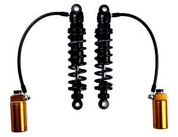

# Öhlins STX 36 Blackline HD 778 rear shocks

[All parts](../README.md) · [System](../systems/rear-suspension.md)

| Field | Record |
| --- | --- |
| Status | Installed — owner reported |
| Quantity | 1  |
| Part number | HD 778 |
| Part-number evidence | Manufacturer catalog match; verify received part label |
| Order / source | Owner-confirmed installed equipment |
| Documentation checked | 2026-10-23 |

## Product and installation documents

- [Product reference](https://www.ohlins.eu/en/products/motorcycle/hd-778-3105-mm-blackline--7538/)
- [HD 778 mounting instructions](https://www.ohlins.eu/download/db/Ohlins_DTC_mounting-instruction-oehlins-motorcycle-hd--00003896.pdf) — Exact product family
- [Road & Track owner manual](https://www.ohlins.eu/download/db/Ohlins_DTC_owners-manual-oehlins-motorcycle-road--00001235.pdf) — Exact product family
- [Downloaded PDF copy: HD 778 mounting instructions](../manuals/ohlins-hd778-6b3ba382.pdf)
- [Downloaded PDF copy: Road & Track owner manual](../manuals/ohlins-hd778-a299fe15.pdf)

## Build notes

- Official catalog lists pair, 310.5 mm length, 78.5 mm stroke; current listed spring 66420-026 (26 N/mm). Installed spring code and setup must be read from actual shock.
- Downloaded mounting manual: installed-assets/ohlins-hd778.pdf.

## Kit / assembly itemization

Components are grouped with this product. Separately indexed equipment and assembly references are not additional purchases. Read each row’s inclusion note.

| Included component | Quantity | Part number | Reference | Inclusion / identification note |
| --- | --- | --- | --- | --- |
| Shock absorber | 2 | HD 778 | [Kit/manual parts reference](https://www.ohlins.eu/download/db/Ohlins_DTC_mounting-instruction-oehlins-motorcycle-hd--00003896.pdf) | Manufacturer part-list reference; standalone sale link not verified |
| Bracket base | 2 | 61125-17 | [Kit/manual parts reference](https://www.ohlins.eu/download/db/Ohlins_DTC_mounting-instruction-oehlins-motorcycle-hd--00003896.pdf) | Manufacturer part-list reference; standalone sale link not verified |
| Bracket | 2 | 61125-15 | [Kit/manual parts reference](https://www.ohlins.eu/download/db/Ohlins_DTC_mounting-instruction-oehlins-motorcycle-hd--00003896.pdf) | Manufacturer part-list reference; standalone sale link not verified |
| Reservoir bracket 44 | 2 | 03102-05 | [Kit/manual parts reference](https://www.ohlins.eu/download/db/Ohlins_DTC_mounting-instruction-oehlins-motorcycle-hd--00003896.pdf) | Manufacturer part-list reference; standalone sale link not verified |
| 5/16-18 UNC x 1-3/4 screw | 4 | 03128-06 | [Kit/manual parts reference](https://www.ohlins.eu/download/db/Ohlins_DTC_mounting-instruction-oehlins-motorcycle-hd--00003896.pdf) | Manufacturer part-list reference; standalone sale link not verified |
| M6x14 screw | 10 | 00382-16 | [Kit/manual parts reference](https://www.ohlins.eu/download/db/Ohlins_DTC_mounting-instruction-oehlins-motorcycle-hd--00003896.pdf) | Manufacturer part-list reference; standalone sale link not verified |
| Spacer 9/14.5-14.2 | 2 | 61122-01 | [Kit/manual parts reference](https://www.ohlins.eu/download/db/Ohlins_DTC_mounting-instruction-oehlins-motorcycle-hd--00003896.pdf) | Manufacturer part-list reference; standalone sale link not verified |
| Spacer 9/14.5-23.1 | 2 | 61122-03 | [Kit/manual parts reference](https://www.ohlins.eu/download/db/Ohlins_DTC_mounting-instruction-oehlins-motorcycle-hd--00003896.pdf) | Manufacturer part-list reference; standalone sale link not verified |
| Spacer 9/14.5-7 | 2 | 61122-04 | [Kit/manual parts reference](https://www.ohlins.eu/download/db/Ohlins_DTC_mounting-instruction-oehlins-motorcycle-hd--00003896.pdf) | Manufacturer part-list reference; standalone sale link not verified |
| Washer 13/28.6/2.3 | 4 | 60050-02 | [Kit/manual parts reference](https://www.ohlins.eu/download/db/Ohlins_DTC_mounting-instruction-oehlins-motorcycle-hd--00003896.pdf) | Manufacturer part-list reference; standalone sale link not verified |
| Öhlins sticker set | 1 | 10207-01 | [Kit/manual parts reference](https://www.ohlins.eu/download/db/Ohlins_DTC_mounting-instruction-oehlins-motorcycle-hd--00003896.pdf) | Manufacturer part-list reference; standalone sale link not verified |
| Preload adjustment tool | 1 | 03199-01 | [Kit/manual parts reference](https://www.ohlins.eu/download/db/Ohlins_DTC_mounting-instruction-oehlins-motorcycle-hd--00003896.pdf) | Manufacturer part-list reference; standalone sale link not verified |
| Owner manual | 1 | 07241-02 | [Kit/manual parts reference](https://www.ohlins.eu/download/db/Ohlins_DTC_mounting-instruction-oehlins-motorcycle-hd--00003896.pdf) | Manufacturer part-list reference; standalone sale link not verified |

**Kit documentation gap:** Some internal parts have only an illustrated kit/manual reference; separate retail listings or service SKUs were not verified. Do not treat a parent-kit link as a standalone component offer.

## Evidence

- Owner conversation history; installed state reported by owner.
- Prior project inventory: Street_Glide_Master_Parts.xlsx, October 20, 2026, worksheet row 29.

## Builder record

- [ ] Received and box label matched
- [ ] Hardware and instructions present
- [ ] Installed / retained / superseded decision recorded
- [ ] Function checked

Installed date: __________  Technician: __________

Notes: ____________________________________________________
