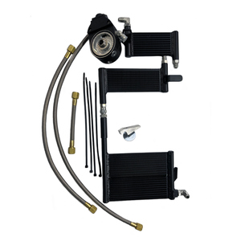

# Touring Bagger Milwaukee 8 Oil-Cooled 2017-Present

[All parts](../README.md) · [System](../systems/cooling.md)

| Field | Record |
| --- | --- |
| Status | Shipped |
| Quantity | 1  |
| Part number | SQ7212655 |
| Part-number evidence | Order / packing-slip evidence |
| Order / source | OilBud 00375 |
| Order date | 2026-10-13 |
| Documentation checked | 2026-10-23 |

## Product and installation documents

- [Product reference](https://www.harleyoilcoolers.com/shop/p/touring-bagger-m8-oil-cooled)
- [Prior inventory reference (may illustrate product family)](https://www.harleyoilcoolers.com/shop)
- [M8 oil-cooled installation guide](https://www.harleyoilcoolers.com/s/Harley-Davidson-Touring-Bagger-M8-Oil-Cooled-2017-2021-Installation-Guide.pdf) — Exact product family
- [Downloaded PDF copy: M8 oil-cooled installation guide](../manuals/oilbud-03b1d6aa.pdf)

## Build notes

- Powder coated adaptor; shipped Oct22. Earlier owner history listed this as installed; latest documentary evidence is shipment on October 22. Physical installation needs confirmation.
- Current product is labeled 2017–Present; linked PDF is titled 2017–2021 and covers this 2018 motorcycle.
- K&P filter is required and sold separately; owner ordered it with the cooler.
- Order #00375. Do not count old installed-history entry as a second cooler.

## Kit / assembly itemization

Components are grouped with this product. Separately indexed equipment and assembly references are not additional purchases. Read each row’s inclusion note.

| Included component | Quantity | Part number | Reference | Inclusion / identification note |
| --- | --- | --- | --- | --- |
| Rear double cooler element | 1 | Not published | [Kit/manual parts reference](https://www.harleyoilcoolers.com/s/Harley-Davidson-Touring-Bagger-M8-Oil-Cooled-2017-2021-Installation-Guide.pdf) | Manufacturer part-list reference; standalone sale link not verified |
| Middle cooler element | 1 | Not published | [Kit/manual parts reference](https://www.harleyoilcoolers.com/s/Harley-Davidson-Touring-Bagger-M8-Oil-Cooled-2017-2021-Installation-Guide.pdf) | Manufacturer part-list reference; standalone sale link not verified |
| Front cooler element | 1 | Not published | [Kit/manual parts reference](https://www.harleyoilcoolers.com/s/Harley-Davidson-Touring-Bagger-M8-Oil-Cooled-2017-2021-Installation-Guide.pdf) | Manufacturer part-list reference; standalone sale link not verified |
| Inner adapter plate | 1 | Not published | [Kit/manual parts reference](https://www.harleyoilcoolers.com/s/Harley-Davidson-Touring-Bagger-M8-Oil-Cooled-2017-2021-Installation-Guide.pdf) | Manufacturer part-list reference; standalone sale link not verified |
| Outer adapter plate | 1 | Not published | [Kit/manual parts reference](https://www.harleyoilcoolers.com/s/Harley-Davidson-Touring-Bagger-M8-Oil-Cooled-2017-2021-Installation-Guide.pdf) | Manufacturer part-list reference; standalone sale link not verified |
| Adapter tube nut | 1 | Not published | [Kit/manual parts reference](https://www.harleyoilcoolers.com/s/Harley-Davidson-Touring-Bagger-M8-Oil-Cooled-2017-2021-Installation-Guide.pdf) | Manufacturer part-list reference; standalone sale link not verified |
| Braided stainless / Teflon hoses | Set | Not published | [Kit/manual parts reference](https://www.harleyoilcoolers.com/s/Harley-Davidson-Touring-Bagger-M8-Oil-Cooled-2017-2021-Installation-Guide.pdf) | Manufacturer part-list reference; standalone sale link not verified |
| JIC/ORB fittings | Set | Not published | [Kit/manual parts reference](https://www.harleyoilcoolers.com/s/Harley-Davidson-Touring-Bagger-M8-Oil-Cooled-2017-2021-Installation-Guide.pdf) | Manufacturer part-list reference; standalone sale link not verified |
| O-rings and mounting hardware | Set | Not published | [Kit/manual parts reference](https://www.harleyoilcoolers.com/s/Harley-Davidson-Touring-Bagger-M8-Oil-Cooled-2017-2021-Installation-Guide.pdf) | Manufacturer part-list reference; standalone sale link not verified |
| Aluminum wedge clamp | 1 | Not published | [Kit/manual parts reference](https://www.harleyoilcoolers.com/s/Harley-Davidson-Touring-Bagger-M8-Oil-Cooled-2017-2021-Installation-Guide.pdf) | Manufacturer part-list reference; standalone sale link not verified |

**Kit documentation gap:** Some internal parts have only an illustrated kit/manual reference; separate retail listings or service SKUs were not verified. Do not treat a parent-kit link as a standalone component offer.

## Evidence

- Gmail message 1a137de11bd3fc23; order reference OilBud 00375
- Gmail message 1a16433b504ec55f; order reference OilBud 00375
- Prior project inventory: Street_Glide_Master_Parts.xlsx, October 20, 2026, worksheet row 20.

## Builder record

- [ ] Received and box label matched
- [ ] Hardware and instructions present
- [ ] Installed / retained / superseded decision recorded
- [ ] Function checked

Installed date: __________  Technician: __________

Notes: ____________________________________________________
