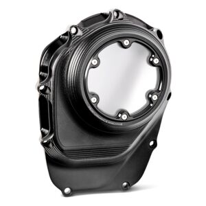

# Vision Cam Cover For Harley Milwaukee-Eight 2017-2026

[All parts](../README.md) · [System](../systems/engine.md)

*Photo: Order-confirmation catalog photograph; finish must follow Black Ops order variant, not the appearance of a generic thumbnail.*

| Field | Record |
| --- | --- |
| Status | Shipped |
| Quantity | 1  |
| Part number | 0177-2082M-SMB |
| Part-number evidence | Catalog match to ordered description; order email does not print this SKU |
| Order / source | Cycle Gear 58911915 |
| Order date | 2026-10-20 |
| Variant | Black Ops; shipped Oct21. |
| Documentation checked | 2026-10-23 |

## Product and installation documents

- [Product reference](https://www.cyclegear.com/parts/performance-machine-vision-cam-cover-for-harley-milwaukee-eight-2017-2020)
- [Manufacturer product](https://www.performancemachine.com/product/255/vision-cam-cover/black-ops)
- [Performance Machine installation instruction index](https://www.performancemachine.com/installation-instructions) — Matching Vision M8 manual not located. The generic Cam Cover ZIP was inspected and contains a 2012 Scallop-cover instruction; do not use it for this product.

## Build notes

- Black Ops; shipped Oct21.
- This is the ordered CAM cover. The cancelled matching derby cover is excluded.
- Obtain the exact 0177-2082M-SMB/M8 Vision instructions from the included packet or Performance Machine before relying on a generic cam-cover torque sequence.

## Kit / assembly itemization

Components are grouped with this product. Separately indexed equipment and assembly references are not additional purchases. Read each row’s inclusion note.

| Included component | Quantity | Part number | Reference | Inclusion / identification note |
| --- | --- | --- | --- | --- |
| Vision M8 cam cover in Black Ops finish | 1 | 0177-2082M-SMB | [Parent product / kit reference](https://www.performancemachine.com/product/255/vision-cam-cover/black-ops) |  |
| Cam cover gasket | 1 | Not published | [Parent product / kit reference](https://www.performancemachine.com/product/255/vision-cam-cover/black-ops) | Included; separate gasket SKU not verified. |
| Mounting hardware | one set | Not published | [Parent product / kit reference](https://www.performancemachine.com/product/255/vision-cam-cover/black-ops) | Included; exact hardware packet SKUs not verified. |

**Kit documentation gap:** Some internal parts have only an illustrated kit/manual reference; separate retail listings or service SKUs were not verified. Do not treat a parent-kit link as a standalone component offer.

## Evidence

- Gmail message 1a15b17f50f52855; order reference Cycle Gear 58911915
- Public source: https://www.cyclegear.com/parts/performance-machine-vision-cam-cover-for-harley-milwaukee-eight-2017-2020
- Public source: https://www.performancemachine.com/product/255/vision-cam-cover/black-ops
- Public source: https://www.performancemachine.com/installation-instructions
- Prior project inventory: Street_Glide_Master_Parts.xlsx, October 20, 2026, worksheet row 27.

## Builder record

- [ ] Received and box label matched
- [ ] Hardware and instructions present
- [ ] Installed / retained / superseded decision recorded
- [ ] Function checked

Installed date: __________  Technician: __________

Notes: ____________________________________________________
