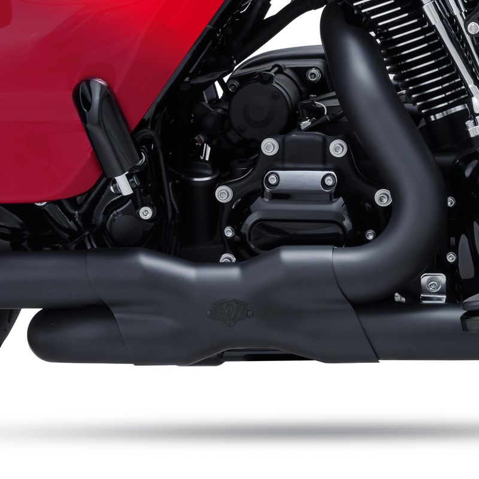

# Vance & Hines Power Duals head pipes

[Home](../README.md) · [All parts A–Z](../PARTS_INDEX.md) · [System](../systems/exhaust.md)

| Field | Record |
| --- | --- |
| Status | Installed — owner reported |
| Quantity | 1  |
| Part number | Not confirmed |
| Order / source | Owner-confirmed installed equipment |
| Documentation checked | 2026-10-23 |

## Product and installation documents

- [Product reference](https://www.vanceandhines.com/product/41/power-duals)
- [Official instruction finder](https://instructions.vanceandhines.com/) — Exact installed SKU must be read before selecting file

## Build notes

- Family is confirmed; finish, PCX versus earlier version and exact part number remain unknown.
- Current product page lists 16371 and 46371 current manuals. Older 46871 manual is a different revision/product: do not silently substitute.
- Photo is manufacturer black reference image, not confirmation of installed finish.
- Power Duals are headers, not a complete muffler kit. Installed slip-on brand/model remains unconfirmed.

## Evidence

- Owner conversation history; installed state reported by owner.
- Prior project inventory: Street_Glide_Master_Parts.xlsx, October 20, 2026, worksheet row 19.

## Builder record

- [ ] Received and box label matched
- [ ] Hardware and instructions present
- [ ] Installed / retained / superseded decision recorded
- [ ] Function checked

Installed date: __________  Technician: __________

Notes: ____________________________________________________
